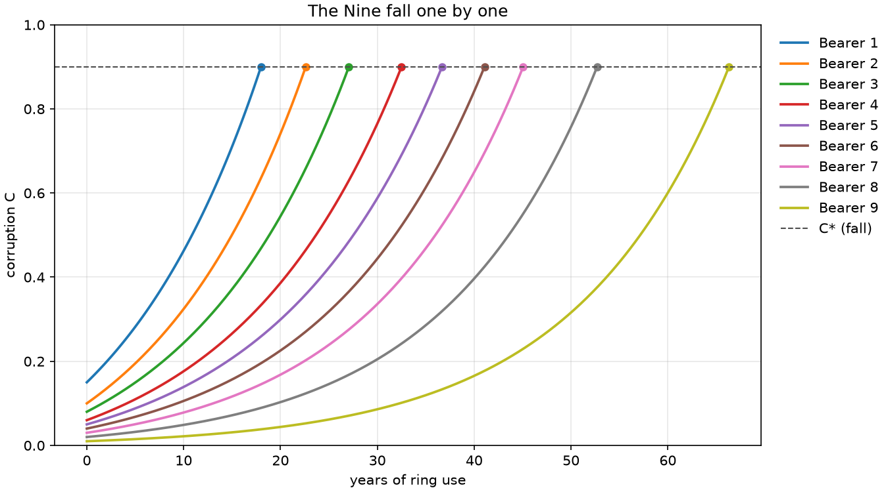
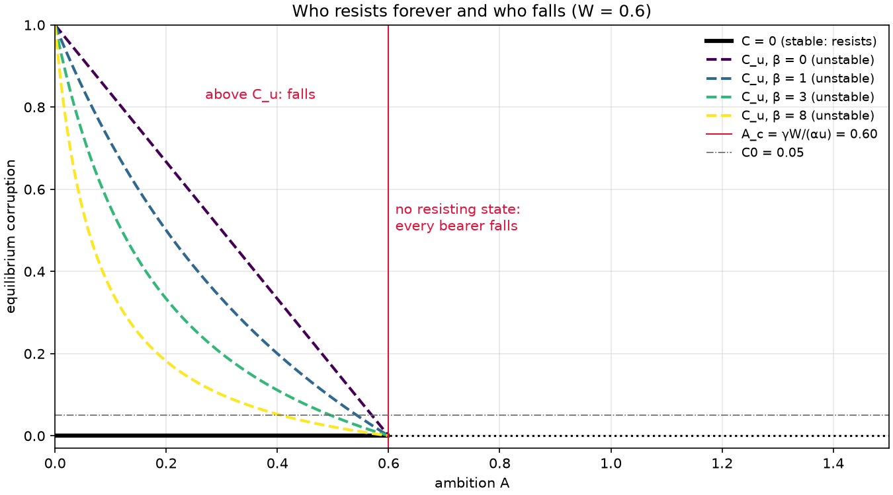
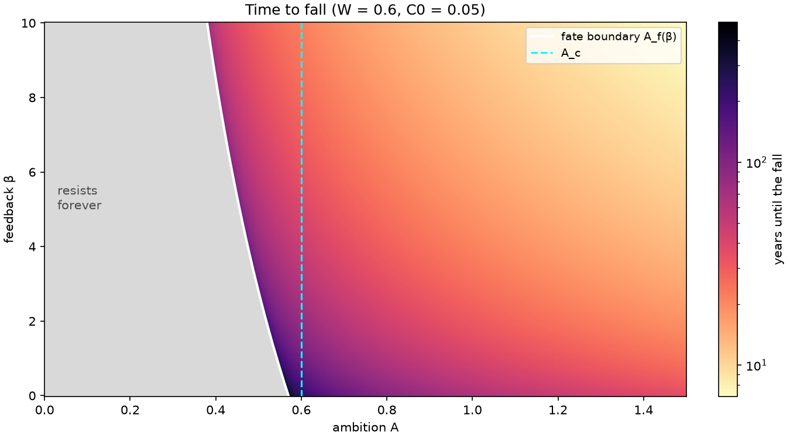
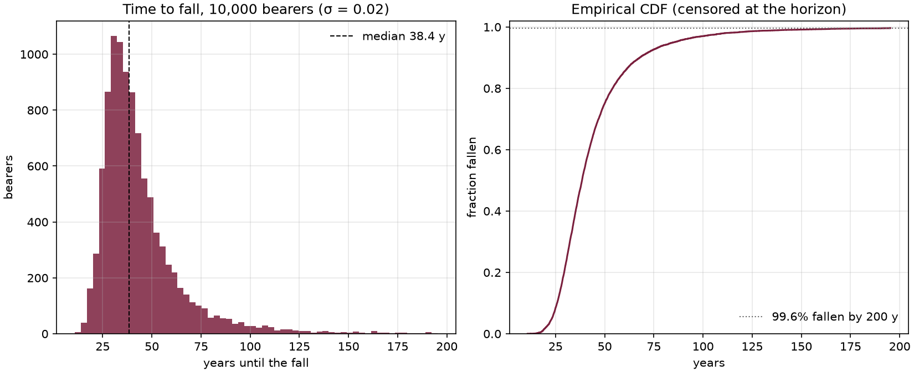
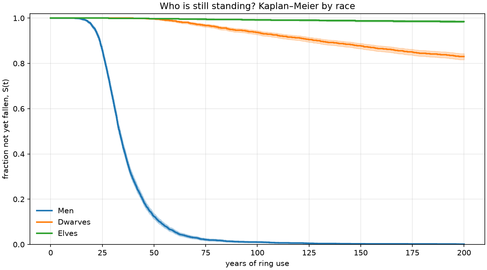
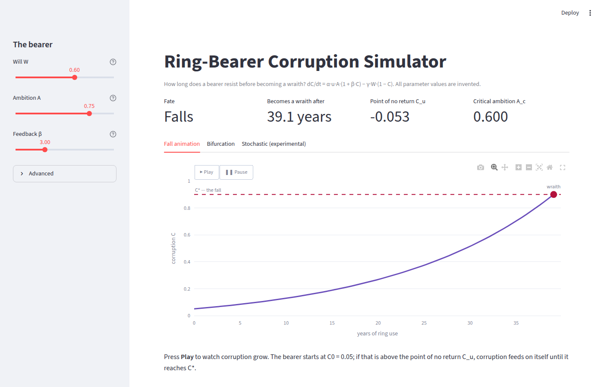
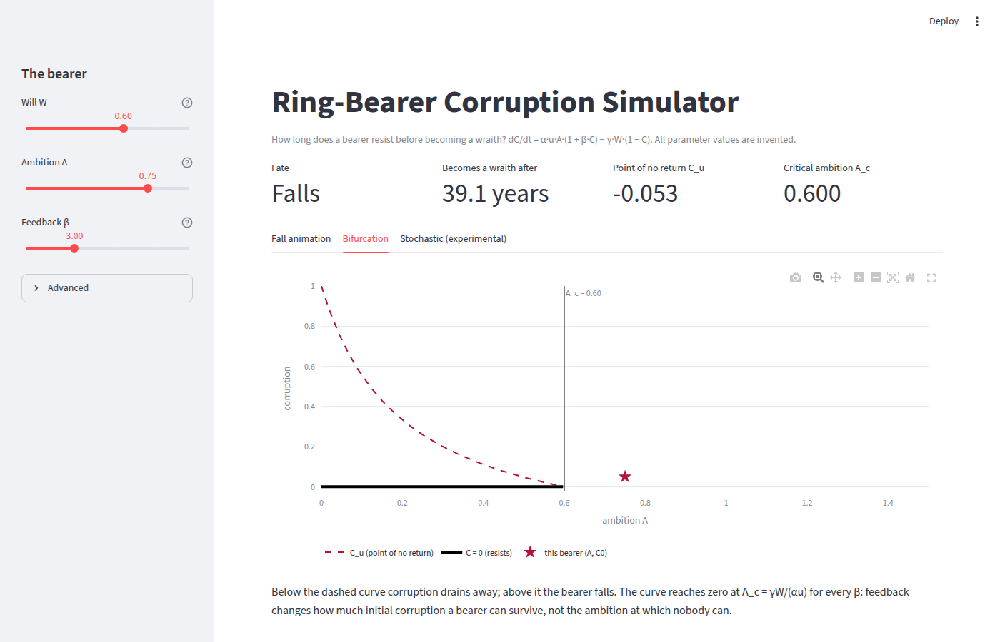

# Ring-Bearer Corruption Simulator

[](https://github.com/GMCavalheri/ring-bearer-corruption-simulator/actions/workflows/ci.yml)

**How long does a bearer resist before becoming a wraith, and which small changes in character alter their whole fate?**

Project 1 of the **Dark Lord Systems** series: ten projects that each model the same Tolkien idea, power as control over wills, with a different technique. This one uses ODE and SDE modeling, bifurcation analysis, Monte Carlo simulation and survival analysis.

Lore basis: the bearers of the Nine fell one by one, according to their native strength and initial intent ([Tolkien Forum](https://thetolkien.forum/threads/the-early-work-of-the-nine-rings.16421/)); the Dwarves did not submit ([Wikipedia](https://en.wikipedia.org/wiki/Sauron)).



## Results at a glance

| Question | Answer (under the assumptions below) |
|---|---|
| How long do the Nine last? | 18 to 66 years of constant use, in order of will and ambition ([notebook 01](notebooks/01_deterministic.ipynb)) |
| Does a small change matter? | Raising bearer 9's will from 0.79 to 0.84 turns a fall at 66 years into resisting forever |
| Where is the point of no return? | At C_u = (γW − αuA)/(αuAβ + γW). Nobody resists once ambition passes A_c = γW/(αu), whatever β is ([notebook 02](notebooks/02_bifurcation.ipynb)) |
| What does noise do? | In 10,000 noisy bearers, 99.6% fall within 200 years (median 38 y), against 94% without noise: bad luck pushes resisters past C_u ([notebook 03](notebooks/03_stochastic.ipynb)) |
| Which race lasts? | After 200 years: Men 0.1% standing (median fall 33 y), Dwarves 83%, Elves 98%. Without the greed side effect the Dwarf median drops to 53 y ([notebook 04](notebooks/04_races.ipynb)) |

## The model

Each bearer has will **W**, ambition **A** and ring usage **u(t)**. Corruption **C** follows

```math
\frac{dC}{dt} = \alpha \, u(t) \, A \, (1 + \beta C) - \gamma \, W \, (1 - C)
```

and the bearer becomes a wraith when C reaches the threshold **C\***. C is clamped at 0.

### What the equation actually does

For constant usage the right-hand side is linear in C:

```math
\frac{dC}{dt} = a\,C + b, \qquad a = \alpha u A \beta + \gamma W > 0, \qquad b = \alpha u A - \gamma W
```

- **One unstable fixed point, the point of no return:** $C_u = -b/a = \dfrac{\gamma W - \alpha u A}{\alpha u A \beta + \gamma W}$. Below it, corruption drains to zero and the bearer resists forever. Above it, corruption grows until the fall.
- **Closed-form fall time:** $t_{fall} = \dfrac{1}{a}\ln\dfrac{a C^* + b}{a C_0 + b}$. The code uses this log-difference form because the textbook $\ln\frac{C^*-C_u}{C_0-C_u}$ overflows when W is tiny. The `solve_ivp` result matches it to a relative error of 1e-6.
- **Bifurcation at the critical ambition:** $A_c = \gamma W/(\alpha u)$. There the resisting state C = 0 loses stability and C_u leaves [0, 1] through zero. **A_c does not depend on β.**
- **What β does:** a bearer who starts at C0 > 0 falls once $A > A_f(\beta) = \dfrac{\gamma W (1 - C_0)}{\alpha u (1 + \beta C_0)}$. Feedback therefore matters only for bearers who are already partly corrupted when they take the ring. It controls how big a head start in corruption is fatal, and how fast the fall comes.

> PLAN.md says "the feedback term β creates the point of no return". The math disagrees: the point of no return exists even with β = 0, because the recovery term γW(1 − C) weakens as corruption grows, which is positive feedback on its own. β moves the fate boundary and speeds the fall. The model is implemented exactly as specified, and this README describes what it does.

### Stochastic version

```math
dC = \big[\alpha u A (1 + \beta C) - \gamma W (1 - C)\big]\,dt + \sigma\, dB_t
```

It is solved by Euler–Maruyama with reflection at 0 and absorption at C\*; a fall inside a step is placed by linear interpolation. Bearers are vectorized and split into fixed blocks, each with its own `SeedSequence` child, so a run gives bit-identical results for any number of worker processes.

### Races

Each race draws W, A and C0 from Beta distributions and has its own γ. **Dwarves** add a greed side effect: a share κ of the ring's pull feeds greed instead of submission,

```math
\frac{dG}{dt} = \kappa\,\alpha u A, \qquad \text{corruption sees } (1-\kappa)\,\alpha u A.
```

Fall times are right-censored at the horizon and compared with Kaplan–Meier estimators and log-rank tests (`lifelines`).

## Assumptions

Every value here is invented for this study. None comes from the books. Time is in years of ring use.

| Symbol | Meaning | Default |
|---|---|---|
| α | corruption rate per unit of usage × ambition | 0.02 / year |
| β | positive feedback of existing corruption | 3 |
| γ | recovery rate per unit of will | 0.02 / year |
| C\* | fall threshold | 0.9 |
| C0 | corruption when the ring is received | 0.05 |
| u | ring usage (fraction of time worn) | 1 (constant) |
| W, A | will and ambition | in [0, 1] |
| σ | noise intensity | 0.02 / √year |
| dt | Euler–Maruyama step | 0.05 years |
| horizon | Monte Carlo censoring time | 200 years |

**The Nine** (notebook 01), as (W, A, C0): (0.30, 0.95, 0.15), (0.40, 0.90, 0.10), (0.50, 0.85, 0.08), (0.55, 0.80, 0.06), (0.60, 0.78, 0.05), (0.66, 0.78, 0.04), (0.72, 0.80, 0.03), (0.76, 0.80, 0.02), (0.79, 0.80, 0.01).

**Monte Carlo population** (notebook 03): W, A and C0 are Beta-distributed with means 0.6, 0.75 and 0.05, concentration 20.

**Races** (notebook 04, `src/corruption/races.py`), Beta concentration 20:

| Race | mean W | mean A | mean C0 | γ | greed share κ |
|---|---|---|---|---|---|
| Men | 0.55 | 0.80 | 0.05 | 0.020 | 0 |
| Dwarves | 0.60 | 0.70 | 0.05 | 0.025 | 0.5 |
| Elves (control) | 0.85 | 0.45 | 0.02 | 0.030 | 0 |

## Figures

| | |
|---|---|
|  |  |
|  |  |

## The app

```bash
uv run streamlit run app/streamlit_app.py
```

Sliders for W, A and β (plus α, γ, C\*, C0, usage and horizon under *Advanced*), a live fate readout, an animated fall and a bifurcation view that marks the bearer against the point-of-no-return curve. The stochastic tab is experimental and off by default; turn it on with `RBCS_EXPERIMENTAL_SDE=1` (see [docs/flags.md](docs/flags.md)).

| Fall animation | Bifurcation view |
|---|---|
|  |  |

## Quickstart

Requires [uv](https://docs.astral.sh/uv/) and Python 3.11 or newer.

```bash
uv sync
```

```bash
uv run pytest
```

```bash
uv run pytest --nbmake notebooks/
```

Library use:

```python
from corruption.model import BearerParams, simulate, fate, unstable_fixed_point

p = BearerParams(W=0.6, A=0.75, beta=3.0)
traj = simulate(p, t_max=200)
print(fate(p), traj.fall_time, unstable_fixed_point(p))
```

## Repository layout

```
src/corruption/
    model.py          # ODE, closed form, fixed point, critical ambition (pure: portable to C++)
    bifurcation.py    # (A, β) sweeps, fate boundary
    stochastic.py     # Euler–Maruyama, Monte Carlo, populations
    races.py          # race presets, survival table, Kaplan–Meier, log-rank
    plotting.py       # Matplotlib figures (notebooks, README)
    interactive.py    # Plotly figures (app)
    flags.py          # env-var feature flags
tests/unit/           # fast, pure tests incl. Hypothesis properties
tests/scenario/       # solver agreement, parallel determinism, noise limits
tests/app/            # Streamlit AppTest smoke tests
notebooks/            # 01 deterministic, 02 bifurcation, 03 stochastic, 04 races
app/streamlit_app.py
docs/                 # figures, screenshots, flag registry
```

`model.py` is a pure function of (W, A, α, β, γ, u(t)) with no plotting or I/O, so Project 5 (the C++ "Dark Lord" game) can port it as its bearer-corruption system.

## Engineering practices

An honest list of what is in place and where it lives.

| Practice | Status | Where |
|---|---|---|
| Unit tests, including Hypothesis properties (C stays in [0, C\*]; more ambition never delays the fall; more will never hastens it) | Running in CI | `tests/unit` |
| Coverage gate (90%; currently 99%) | Running in CI | `pyproject.toml`, `unit` job |
| Scenario tests: ODE vs closed form on random bearers, sweep vs ODE on every grid cell, serial vs parallel Monte Carlo bit-for-bit, σ → 0 limit | Running in CI | `tests/scenario` |
| Notebooks executed end to end | Running in CI | `notebooks` job (nbmake) |
| App smoke tests: real script run headless, fate flipped by sliders, flag on and off | Running in CI | `tests/app`, `app-smoke` job |
| Lint, format and strict typing | Running in CI | ruff, `mypy --strict` on `src` and `app` |
| Secret scan and dependency audit | Running in CI | gitleaks, pip-audit on the locked dependencies |
| Dependency updates | Weekly | Dependabot (uv and GitHub Actions) |
| Feature flags | Running locally and in tests | `src/corruption/flags.py`, `docs/flags.md` |
| Reproducibility | Built in | explicit seeds everywhere; `SeedSequence` per block |

Deliberately left out:

- **Hosted staging, deploy, observability and rollback.** Nothing is deployed: the app runs locally. Deploying to Streamlit Community Cloud is a manual step for later. Until then, rollback means `git revert` or checking out a release tag.
- **Branch protection and AI pre-merge review.** It is a solo private repository with direct pushes to `main`. Every push runs the full CI.
- **OpenFeature.** For one local app, plain environment variables do the job. The flag module keeps the same semantics: default off, and a kill switch that works without a redeploy.

## Extensions (not implemented)

- **Inverse inference:** estimate W, A, β from observed fall times with MCMC (PyMC).
- **Optimal control from Sauron's side:** find the usage u(t) that corrupts fastest without alerting the bearer. This is a dynamic programming / Markov decision process problem, the same technique behind optimal maintenance and replacement policies.

## Copyright

The code is MIT-licensed ([LICENSE](LICENSE)). Names and lore belong to the Tolkien Estate and are used here for a non-commercial study simulation. No passages from the books are reproduced, and every parameter value is the author's own assumption.
