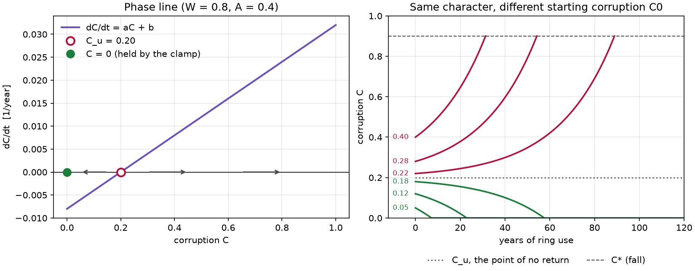
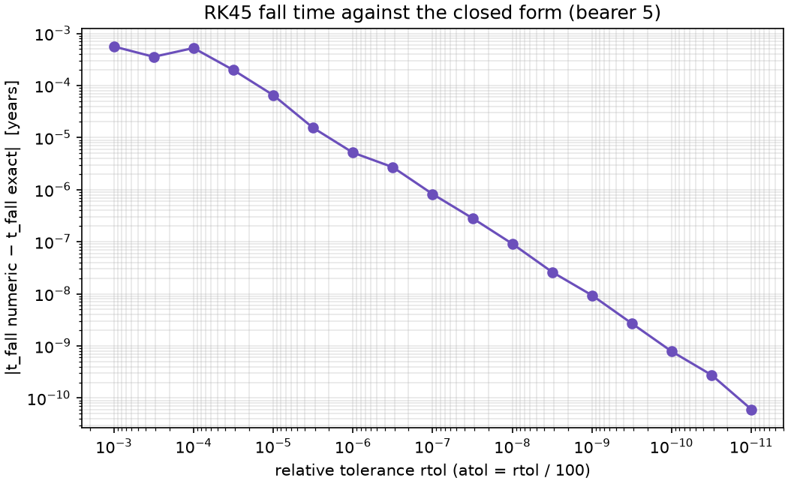

# Lesson 1 · A corruption ODE you can solve by hand

> *A ring pulls; a will pushes back. Write both as rates, and corruption becomes a differential
> equation. This one looks nonlinear, but it is a linear equation in disguise. You can solve it on
> paper, which lets you check every number the computer gives you.*

**Code:** [`src/corruption/model.py`](../../src/corruption/model.py) ·
**Notebook:** [`01_deterministic.ipynb`](../../notebooks/01_deterministic.ipynb) ·
**Previous:** [Course index](README.md) ·
**Next:** [Lesson 2 — The point of no return](02-bifurcation.md)

## Learning objectives

By the end of this lesson you should be able to

1. explain what each term of the corruption ODE models, and what units its parameters carry;
2. rewrite the right-hand side as $aC + b$ and solve the equation in closed form;
3. derive the time to fall, and explain why the code uses a log-difference form of it;
4. integrate the ODE with `scipy.integrate.solve_ivp`, stop it at the fall with an event, and choose
   tolerances by comparing against the closed form;
5. handle a time-varying usage $u(t)$ without letting the integrator step over it.

---

## 1. From a story to a rate equation

The plan describes a bearer with three traits: **will W**, **ambition A** and **ring usage
u(t)**. Their state is one number, **corruption C**, from 0 (untouched) to 1 (fully dominated).
The bearer becomes a wraith when C reaches a threshold **C\***.

A differential equation says how fast the state changes. Two forces act on C:

```math
\frac{dC}{dt} = \underbrace{\alpha\,u(t)\,A\,(1 + \beta C)}_{\text{the ring's pull}} \;-\; \underbrace{\gamma\,W\,(1 - C)}_{\text{the will's resistance}}
```

| Term | Story | Modeling choice |
|---|---|---|
| $\alpha u A$ | the ring corrupts in proportion to how much it is worn and how ambitious the bearer is | rate α per year per unit of usage × ambition |
| $(1 + \beta C)$ | corruption feeds on itself: a corrupted mind resists less and wants more | linear positive feedback, strength β |
| $\gamma W$ | will drains corruption | rate γ per year per unit of will |
| $(1 - C)$ | the will has less to work with as corruption grows | resistance fades linearly to zero at C = 1 |

Two more modeling decisions matter:

- **C cannot go below zero.** A strong will drains corruption, but not into negative values. The
  code *clamps* the right-hand side: at C ≤ 0, a negative rate becomes zero.
- **The fall is a threshold crossing.** Once C reaches C\* = 0.9 the bearer obeys the One, and the
  simulation stops.

Every parameter value in this project is invented (see the README's assumptions table). Time is
in years of ring use, so α and γ are rates per year. The defaults are α = γ = 0.02/year, β = 3,
C\* = 0.9 and C0 = 0.05.

## 2. A linear equation in disguise

The product $(1 + \beta C)$ and the factor $(1 - C)$ make the equation *look* nonlinear. Expand it:

```math
\frac{dC}{dt} = \alpha u A + \alpha u A \beta\,C - \gamma W + \gamma W\,C
= \underbrace{(\alpha u A \beta + \gamma W)}_{a}\,C + \underbrace{(\alpha u A - \gamma W)}_{b}
```

For constant usage u this is the simplest ODE there is: $\dot C = aC + b$, with constant
coefficients.

- **a > 0 always** (unless the bearer has no will and no ambition). Both terms push in the same
  direction: the more corrupted the bearer, the faster corruption grows. That is true even
  without β, because the resistance $\gamma W(1-C)$ *shrinks* as C grows. This fact matters again
  in Lesson 2.
- **The sign of b** decides what happens to an uncorrupted bearer: b > 0 means the ring's pull
  beats the will even at C = 0.

## 3. Solving it on paper

Set $\dot C = 0$ to find the equilibrium:

```math
C_u = -\frac{b}{a} = \frac{\gamma W - \alpha u A}{\alpha u A\beta + \gamma W}
```

Now write $D = C - C_u$. Then $\dot D = \dot C = aC + b = a(C - C_u) = aD$, whose solution is
$D(t) = D(0)e^{at}$. Back in C:

```math
C(t) = C_u + (C_0 - C_u)\,e^{a t}
```

Because a > 0, the distance from $C_u$ grows exponentially. **$C_u$ is unstable.**

- If $C_0 > C_u$, corruption grows without bound and crosses C\*. The bearer falls.
- If $C_0 < C_u$, corruption shrinks, reaches 0 in finite time, and the clamp holds it there. The
  bearer resists forever.

$C_u$ is the **point of no return**. Lesson 2 studies it properly. Here is what it looks like:



On the left, $dC/dt$ is a straight line crossing zero at $C_u$ = 0.20 (W = 0.8, A = 0.4). The
arrows show the flow: away from $C_u$ on both sides. On the right, six bearers with the same
character but different starting corruption split cleanly at $C_u$. Starting at 0.18 drains to
zero in 58 years; starting at 0.22 falls in 89.

## 4. The time to fall

Set $C(t_{fall}) = C^*$ and solve:

```math
t_{fall} = \frac{1}{a}\ln\frac{C^* - C_u}{C_0 - C_u}
```

That is the textbook form, and it has a trap. Without feedback (β = 0), $a = \gamma W$, so a tiny
will makes $a$ tiny and $C_u = -b/a$ overflows to $-\infty$. Then the ratio is $\infty/\infty$ = NaN.
Property-based testing found exactly this case, at W ≈ 2 × 10⁻³¹³ (Lesson 6). Multiply numerator
and denominator by a:

```math
t_{fall} = \frac{\ln(aC^* + b) - \ln(aC_0 + b)}{a}
```

This form never builds $C_u$, and taking the two logarithms separately avoids overflowing their
ratio. When $a(C^* - C_0)$ is negligible next to $aC_0 + b$, growth is effectively linear, and
the code switches to $t = (C^* - C_0)/(aC_0 + b)$. That is the limit of the formula as a → 0.

The same rewrite gives the fate test without dividing by a:

```math
\text{falls} \iff C_0 > C_u \iff aC_0 + b > 0
```

$aC_0 + b$ is just the initial speed $\dot C(0)$. **A bearer falls exactly when corruption is
growing at the moment they take the ring.**

## 5. Solving it numerically

The closed form needs constant usage. For a general $u(t)$ you need an integrator.
`scipy.integrate.solve_ivp` with its default RK45 method (an explicit Runge–Kutta pair) adapts its
step to keep the local error below `atol + rtol·|C|`.

**Stopping at the fall.** An *event* is a function whose sign change the solver locates exactly:

```python
def fall_event(t, y):
    return y[0] - p.c_star      # crosses zero at the fall
fall_event.terminal = True       # stop integrating there
fall_event.direction = 1.0       # only upward crossings count
```

**The clamp** lives in the right-hand side `rhs()`: if C ≤ 0 and the drift is negative, it
returns 0. Tiny negative undershoots from the integrator are clipped to 0 in the output.

**Choosing tolerances.** Because the closed form exists, the error can be measured instead of
guessed:



The error falls steadily with rtol. At rtol = 1e-3 it is 5.6 × 10⁻⁴ years. The code's default,
rtol = 1e-8 with atol = 1e-10, gives 9 × 10⁻⁸ years: about three seconds over 37 years.

**Time-varying usage.** RK45 picks its own steps, and it can step straight over a short change in
$u(t)$ without seeing it. A bearer with no will who wears the ring only from year 50 to 50.5
should end with C = 0.0593. Without a step cap, `simulate` returns C = 0.05: it never noticed the
pulse. With `max_step=0.1` it gets 0.0593. **Set `max_step` below the shortest feature of u(t).**

## 6. Worked example: bearer 5 of the Nine

Bearer 5 has W = 0.60, A = 0.78 and C0 = 0.05, and wears the ring constantly (u = 1). Use the
defaults α = γ = 0.02/year, β = 3 and C\* = 0.9.

1. **Coefficients.** a = 0.02 × 0.78 × 3 + 0.02 × 0.60 = 0.0468 + 0.0120 = **0.0588/year**.
   b = 0.02 × 0.78 − 0.02 × 0.60 = 0.0156 − 0.0120 = **0.0036/year**.
2. **Point of no return.** $C_u$ = −0.0036/0.0588 = **−0.0612**. It is negative, so even an
   uncorrupted bearer 5 would fall.
3. **Critical ambition.** $A_c = \gamma W/(\alpha u)$ = 0.012/0.02 = **0.60**. Bearer 5's 0.78 is
   above it.
4. **Initial and final speed.** $aC_0 + b$ = 0.00294 + 0.0036 = 0.00654/year (positive: falls).
   $aC^* + b$ = 0.05292 + 0.0036 = 0.05652/year.
5. **Fall time.** ln(0.05652/0.00654) / 0.0588 = ln(8.642) / 0.0588 = 2.1567 / 0.0588 =
   **36.678 years**.
6. **Along the way.** C(10) = 0.139, C(20) = 0.299, C(30) = 0.588. Corruption doubles roughly
   every 12 years ($\ln 2/a$ = 11.8), the signature of exponential growth.

```python
from corruption.model import BearerParams, simulate, fate, unstable_fixed_point, critical_ambition

p = BearerParams(W=0.60, A=0.78, c0=0.05)
traj = simulate(p, t_max=100.0)
fate(p), traj.fall_time            # Fate.FALLS, 36.678
unstable_fixed_point(p)            # -0.0612
critical_ambition(p)               # 0.6
```

The numeric fall time (36.677846717) and the closed form (36.677846809) agree to 9 × 10⁻⁸ years.

## 7. From equations to code

| Concept | Function |
|---|---|
| parameters with validation | `BearerParams(W, A, alpha, beta, gamma, c_star, c0)` |
| right-hand side, clamped at 0 | `rhs(t, c, p, usage)` |
| a and b | `drift_coefficients(p, u)` |
| $C_u$, $A_c$, fate | `unstable_fixed_point`, `critical_ambition`, `fate` |
| closed-form C(t) and t_fall | `analytic_solution`, `analytic_fall_time`, `fall_time_from_coefficients` |
| numerical solution with fall event | `simulate(p, t_max, usage, max_step=...)` → `Trajectory(t, c, fall_time)` |
| constant usage | `constant_usage(u)` |

`model.py` has no plotting, files or UI. It is a pure function of (W, A, α, β, γ, u(t)), so the
C++ game of Project 5 can port it line by line.

The tests ([`tests/unit/test_model.py`](../../tests/unit/test_model.py),
[`tests/scenario/test_solver_agreement.py`](../../tests/scenario/test_solver_agreement.py)) check:
- `rhs` equals the formula and equals $aC + b$;
- the clamp holds at and below zero;
- invalid parameters raise `ParameterError`;
- the numeric fall time matches the closed form to 1e-6 relative error on 40 random bearers;
- the fate predicted from $aC_0 + b$ matches a 100,000-year simulation;
- for any bearer, C stays in [0, C\*], more ambition never delays the fall and more will never
  hastens it (Hypothesis);
- regression cases for the two overflow bugs.

## 8. Common pitfalls

- **Trusting the nonlinear look.** The equation is linear in C. Expand before you reach for a
  numerical method; a closed form is the best test oracle you will ever get.
- **Computing $C_u = -b/a$ first.** It overflows for tiny will. Use the log-difference fall time and
  the sign of $aC_0 + b$.
- **Forgetting the clamp.** Without it, a resisting bearer's corruption goes negative, and "will"
  starts generating anti-corruption from nothing.
- **Letting the solver step over u(t).** Adaptive steps are chosen for accuracy, not to look at
  every point of your input. Cap them with `max_step`.
- **Reading t_fall as a calendar date.** Time here is years *of ring use*. Under 50% usage the
  calendar time is different; that is a different u, not a rescaling (Exercise 2).

## 9. Exercises

1. Compute bearer 1's fall time by hand (W = 0.30, A = 0.95, C0 = 0.15, defaults otherwise), and
   check it with `analytic_fall_time`.
2. Bearer 5 starts wearing the ring only half the time (u = 0.5 constant). Does it still fall?
   What is the smallest constant usage that makes bearer 5 fall?
3. A bearer with W = 0.8, A = 0.4 and C0 = 0.15 resists. How long until corruption reaches
   exactly zero? Check it with `simulate`.
4. Bearer 1 wears the ring in pulses: five years on, five years off. `simulate` gives a fall at
   34.35 years. How many years of actual wear is that, and why is it more than the 17.98 years of
   constant use?
5. Recompute bearer 5's fall time for β = 0, 1, 3 and 8. What does feedback do to the fall time?
   Does β = 0 save bearer 5?

<details>
<summary>Answers</summary>

1. a = 0.02 × 0.95 × 3 + 0.02 × 0.30 = 0.063, b = 0.019 − 0.006 = 0.013.
   $aC_0 + b$ = 0.00945 + 0.013 = 0.02245, $aC^* + b$ = 0.0567 + 0.013 = 0.0697.
   t = ln(0.0697/0.02245)/0.063 = **17.98 years**.
2. With u = 0.5: a = 0.0354, b = −0.0042, so $C_u$ = 0.1186 > C0 = 0.05. **Bearer 5 resists.** It
   falls when $u\,\alpha A(1 + \beta C_0) > \gamma W(1 - C_0)$, that is for
   u > 0.0114/0.01794 = **0.635**. Usage changes the fate, not just the timing.
3. a = 0.04, b = −0.008, $C_u$ = 0.20. From $C(t) = C_u + (C_0 - C_u)e^{at}$ = 0:
   t = ln($C_u/(C_u - C_0)$)/a = ln(0.2/0.05)/0.04 = **34.66 years**. The simulation (20,001
   output points) first shows C = 0 at 34.66 years. After that the clamp holds it at zero.
4. The on-periods are [0, 5), [10, 15), [20, 25) and [30, 34.35]: **19.35 years** of wear. The
   extra 1.35 years pay back what the will recovered during the off-periods, when the drift is
   $-\gamma W(1 - C) < 0$.
5. β = 0: 102.7 y; β = 1: 63.1 y; β = 3: 36.7 y; β = 8: 18.2 y. Feedback speeds the fall a lot, but
   **β = 0 does not save bearer 5**: b > 0 does not depend on β, so the bearer still falls, only
   later. Lesson 2 makes this precise.

</details>

## Key takeaways

- The corruption ODE is linear: $\dot C = aC + b$ with $a = \alpha uA\beta + \gamma W > 0$ and
  $b = \alpha uA - \gamma W$.
- Its only equilibrium $C_u = -b/a$ is unstable: the point of no return. A bearer falls exactly
  when $aC_0 + b > 0$.
- $t_{fall} = [\ln(aC^* + b) - \ln(aC_0 + b)]/a$: the same formula as the textbook one, but safe
  when a is tiny.
- A closed form turns "the solver seems fine" into a measured error. Use it to pick tolerances.
- Adaptive integrators can skip short inputs. Cap the step size when u(t) has short features.

## Further reading

- S. H. Strogatz, *Nonlinear Dynamics and Chaos*, 2nd ed., Ch. 2 (flows on the line).
- W. E. Boyce & R. C. DiPrima, *Elementary Differential Equations*, Ch. 2 (linear first-order
  equations).
- E. Hairer, S. P. Nørsett & G. Wanner, *Solving Ordinary Differential Equations I*, Ch. II
  (Runge–Kutta methods and step-size control).
- SciPy documentation, `scipy.integrate.solve_ivp` (events, tolerances, `max_step`).
