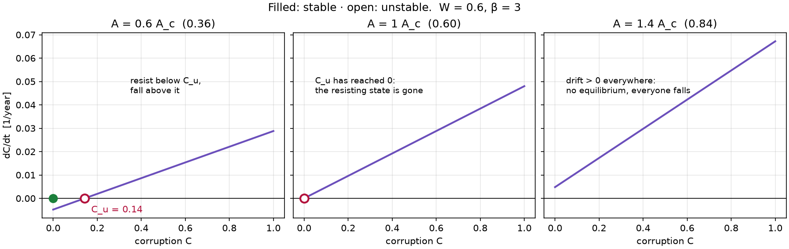
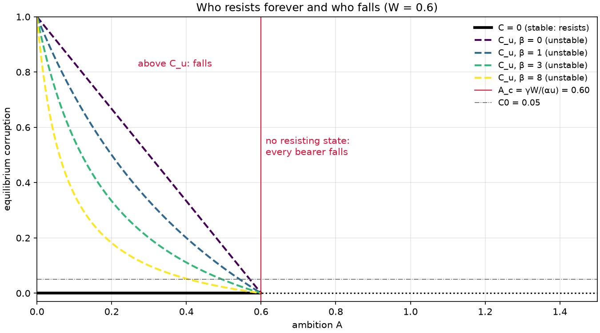
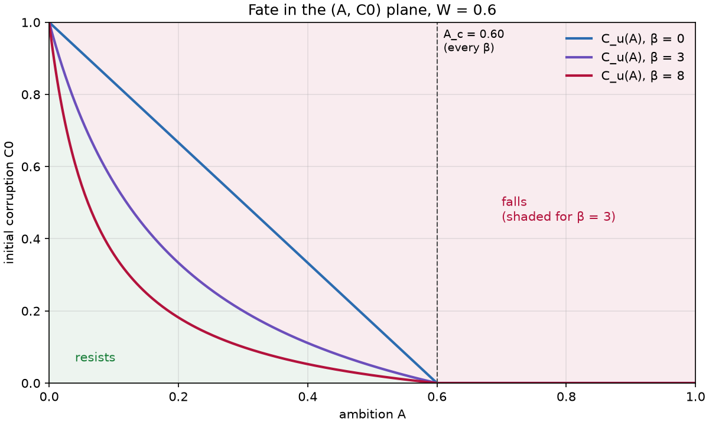
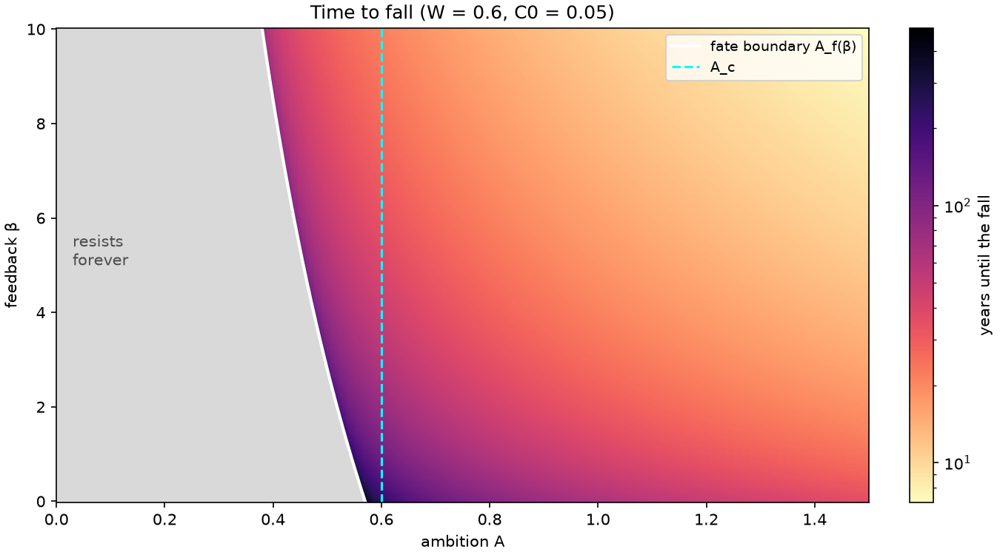

# Lesson 2 · The point of no return

> *Two bearers can differ by a hair of ambition and end in opposite places: one at peace with
> the ring, one a wraith. Bifurcation analysis finds the hair. It also catches a claim in this
> project's own plan that the math does not support.*

**Code:** [`src/corruption/bifurcation.py`](../../src/corruption/bifurcation.py) ·
**Notebook:** [`02_bifurcation.ipynb`](../../notebooks/02_bifurcation.ipynb) ·
**Previous:** [Lesson 1 — A corruption ODE you can solve by hand](01-deterministic-model.md) ·
**Next:** [Lesson 3 — Noise, Euler–Maruyama and first-passage times](03-stochastic-monte-carlo.md)

## Learning objectives

By the end of this lesson you should be able to

1. find the equilibria of a one-dimensional ODE and classify their stability by linearization and
   by the phase line;
2. explain how a boundary (the clamp at C = 0) creates an equilibrium the formula alone does not
   show;
3. locate the bifurcation at the critical ambition $A_c = \gamma W/(\alpha u)$ and prove that it does
   not depend on β;
4. derive the fate boundary $A_f(\beta)$ and explain exactly what feedback changes;
5. tell this bifurcation apart from a saddle-node, and know what a model needs in order to have
   one;
6. sweep a parameter plane with vectorized NumPy instead of a double loop.

---

## 1. Equilibria and their stability

An **equilibrium** (fixed point) of $\dot C = f(C)$ is a value $C_e$ with $f(C_e) = 0$. Near it,
write $C = C_e + \varepsilon$ and expand:

```math
\dot\varepsilon = f'(C_e)\,\varepsilon + O(\varepsilon^2)
```

- $f'(C_e) < 0$: small perturbations decay. The equilibrium is **stable**.
- $f'(C_e) > 0$: they grow. It is **unstable**.

For the corruption model, $f(C) = aC + b$ (Lesson 1), so $f' = a$ everywhere. The interior
equilibrium $C_u = -b/a$ has eigenvalue $a > 0$: **it is unstable**. A perturbation of size ε
grows like $\varepsilon e^{at}$, and $1/a$ is the time it takes to grow by a factor e.

In one dimension you can skip the algebra and read stability off the **phase line**: plot $f(C)$
against C. Where f > 0 the flow moves right, where f < 0 it moves left. An equilibrium with flow
pointing *towards* it is stable; with flow pointing *away* it is unstable.

## 2. The equilibrium the formula does not show

The formula has one equilibrium, but the clamp adds a second. At C = 0 the code sets negative
rates to zero. If $f(0) = b < 0$, the flow pushes into the wall and stops: **C = 0 is a stable
equilibrium** held by the boundary. If $b > 0$, the flow leaves the wall and C = 0 is not an
equilibrium at all.

So the model has two regimes:

| Condition | Equilibria in [0, 1] | Meaning |
|---|---|---|
| $b < 0$, i.e. $A < A_c$ | C = 0 (stable), $C_u \in (0, 1)$ (unstable) | bearers below $C_u$ resist forever |
| $b = 0$, i.e. $A = A_c$ | $C_u = 0$, merged with the wall | the resisting basin has shrunk to a point |
| $b > 0$, i.e. $A > A_c$ | none | every bearer falls |



With W = 0.6 and β = 3: at A = 0.36 the point of no return sits at $C_u$ = 0.14, so any bearer who
starts below 0.14 resists. At A = 0.60 it has slid down to zero. Above that, the drift is positive
everywhere.

## 3. The bifurcation at the critical ambition

A **bifurcation** is a qualitative change in the equilibria as a parameter crosses a value. Here
the parameter is ambition A, and the change happens when b changes sign:

```math
b = \alpha u A - \gamma W = 0 \quad\Longleftrightarrow\quad A_c = \frac{\gamma W}{\alpha u}
```

At $A_c$, the stable wall state C = 0 and the unstable $C_u$ collide and the resisting state
disappears. This resembles a *transcritical* bifurcation (two equilibria meeting and passing
through each other), except that after the collision $C_u$ leaves the domain through the wall.
Such boundary-driven changes are called **boundary-equilibrium bifurcations**.



Now look at what is *not* in $A_c$: **β**. The feedback term multiplies $\alpha u A \cdot C$, and at
C = 0 it vanishes. Whether an uncorrupted bearer can resist depends only on the balance of pull and
will at zero corruption. The diagram shows it: the four $C_u$ curves have different shapes, but all
reach zero at the same $A_c$ = 0.60.

### What PLAN.md got wrong

The plan says "the feedback term β creates the point of no return, which is where the bifurcation
appears". Two parts of that are false:

1. **The point of no return exists at β = 0.** With no feedback, $a = \gamma W > 0$ and
   $C_u = (\gamma W - \alpha uA)/(\gamma W)$, still unstable. The resistance $\gamma W(1 - C)$ weakens
   as C grows, and that is positive feedback on its own.
2. **β does not move the bifurcation.** $A_c$ is independent of β.

The project implements the equation exactly as specified and corrects the description instead.
That is a general rule: when the math and the story disagree, keep the math and fix the story.

## 4. What β actually does: the fate boundary

A bearer who already carries some corruption $C_0 > 0$ falls when $C_0 > C_u$. Solve
$C_0 = C_u(A)$ for A:

```math
C_0(\alpha uA\beta + \gamma W) = \gamma W - \alpha uA
\quad\Longrightarrow\quad
A_f(\beta) = \frac{\gamma W\,(1 - C_0)}{\alpha u\,(1 + \beta C_0)}
```

**β enters only through $\beta C_0$.** For a clean start ($C_0 = 0$), $A_f = A_c$ for every β. For a
partly corrupted start, more feedback lowers the ambition needed to fall. Feedback turns a head
start in corruption into a fall.



In the $(A, C_0)$ plane each curve $C_u(A)$ splits "resists" (below) from "falls" (above). All
three meet the axis at $A_c$ = 0.60, and higher β bends the curve down: less room to recover.



The sweep over $(A, \beta)$ for $C_0$ = 0.05 shows both boundaries together: the white curve
$A_f(\beta)$ bends left as β grows, while the dashed $A_c$ stays vertical.

## 5. Sweeping a plane: vectorize, don't loop

`sweep()` evaluates $C_u$, the fate and the closed-form fall time on a whole grid at once with
`np.meshgrid` and array arithmetic. It decides fate from the sign of $aC_0 + b$, the overflow-safe
test from Lesson 1. On a 300 × 200 grid it took 0.010 s, against 1.08 s for a Python double loop
calling `analytic_fall_time`. That is about **110× faster**, with identical results (a scenario
test checks every cell against the scalar functions and against long ODE runs).

## 6. Worked example: when feedback decides

Take W = 0.6, A = 0.5, C0 = 0.05, and the defaults α = γ = 0.02, u = 1. Compare β = 0 and β = 3.

1. **Critical ambition.** $A_c$ = 0.012/0.02 = 0.60 > 0.5. A bearer starting at zero resists for
   *any* β.
2. **β = 0.** a = 0.012, b = 0.010 − 0.012 = −0.002, $C_u$ = 0.1667. $C_0$ = 0.05 < 0.1667:
   **resists**. Check: $aC_0 + b$ = −0.0014 < 0.
3. **β = 3.** a = 0.02 × 0.5 × 3 + 0.012 = 0.042, b = −0.002, $C_u$ = 0.0476. Now
   $C_0$ = 0.05 > 0.0476: **falls**, because $aC_0 + b$ = +0.0001 > 0.
4. **Fall time at β = 3.** [ln(0.042 × 0.9 − 0.002) − ln(0.0001)]/0.042 = ln(358)/0.042 =
   **140.0 years**. It is slow because the bearer starts barely above the point of no return.
5. **Fate boundary.** $A_f(0)$ = 0.012 × 0.95/0.02 = 0.570 and $A_f(3)$ = 0.570/1.15 = 0.496. Our
   bearer's A = 0.5 sits between them. That is why β flips the fate.

```python
import numpy as np
from corruption.bifurcation import sweep, fate_boundary_ambition, critical_ambition
from corruption.model import BearerParams

base = BearerParams(W=0.6, A=0.0, c0=0.05)    # A and beta of base are ignored by sweep
r = sweep(base, np.linspace(0, 1.5, 301), [0.0, 3.0, 8.0])
critical_ambition(base)                       # 0.6
fate_boundary_ambition(base, [0.0, 3.0, 8.0]) # [0.570, 0.496, 0.407]
r.falls[:, 100], r.fall_time[:, 100]          # A = 0.5: [False, True, True], [inf, 140.0, 37.4]
```

## 7. From equations to code

| Concept | Function |
|---|---|
| $C_u$ on any broadcastable (A, β) | `fixed_point(base, A, beta, u)` |
| $A_c$ | `critical_ambition(base, u)` (re-exported from `model`) |
| $A_f(\beta)$ | `fate_boundary_ambition(base, beta, u)` |
| grid of $C_u$, fate, fall time | `sweep(base, A_values, beta_values, u)` → `Sweep` |
| figures | `plotting.plot_bifurcation`, `plotting.plot_fate_map` |

The tests ([`tests/unit/test_bifurcation.py`](../../tests/unit/test_bifurcation.py),
[`tests/scenario/test_bifurcation_agrees_with_simulation.py`](../../tests/scenario/test_bifurcation_agrees_with_simulation.py))
check:
- $C_u$ crosses zero at $A_c$ for every β, and equals 1 at A = 0;
- `falls` matches the analytic fate boundary on every cell;
- $A_f = A_c$ for a clean start, and $A_f$ decreases with β otherwise;
- fall time is infinite exactly where the bearer resists, and shrinks with A and β;
- every cell of three sweeps agrees with the scalar closed form and with 100,000-year ODE runs.

## 8. Common pitfalls

- **Ignoring the boundary.** The formula has one equilibrium; the clamped model has two. Always ask
  what your constraints do at the edges of the domain.
- **"Feedback creates the tipping point."** In this model it does not. Test such claims against the
  equations before repeating them.
- **Confusing $A_c$ and $A_f$.** $A_c$ is about bearers starting clean; $A_f(\beta)$ is about a
  specific $C_0$. Only the second depends on β.
- **Reading the fate map as a time map.** Near the boundary, fall times diverge (140 years at
  $aC_0 + b$ = 0.0001). Use a log color scale, as `plot_fate_map` does.
- **Looping over a grid in Python.** 60,000 scalar calls cost a second; the vectorized sweep costs
  ten milliseconds.

## 9. Exercises

1. A strong-willed bearer has W = 0.9 and A = 0.85 (defaults otherwise). Find $A_c$. Does the
   bearer resist starting from $C_0$ = 0? From $C_0$ = 0.05?
2. For W = 0.6, A = 0.5 and C0 = 0.05, find the feedback β\* above which the bearer falls. Check
   β = 2.7 and β = 2.9 with `fate`.
3. **A model with a saddle-node.** Replace the resistance by $4\gamma W\,C(1 - C)$: a bearer fights
   hardest at moderate corruption and not at all at C = 0. Keep W = 0.6, β = 3 and the default
   rates. Show the drift is quadratic in C, and find the ambition $A_{sn}$ at which its two
   interior equilibria merge. Where do they merge, and what happens above $A_{sn}$?
4. For W = 0.8, A = 0.4, how long does a bearer starting 0.01 above $C_u$ take to grow that gap by
   a factor e? How long until they reach C\*?
5. Treat usage u as the bifurcation parameter for bearer 5 (W = 0.60, A = 0.78). Find the critical
   usage for a clean start, and the usage above which a start at $C_0$ = 0.05 falls.

<details>
<summary>Answers</summary>

1. $A_c$ = 0.02 × 0.9/0.02 = **0.90**. From $C_0$ = 0: A = 0.85 < $A_c$, so **resists**
   ($C_u$ = 0.0145 > 0). From $C_0$ = 0.05: 0.05 > 0.0145, so it **falls**, at 46.6 years. A strong
   will with a sliver of initial corruption is not enough.
2. Solve $A_f(\beta^*) = A$: $1 + \beta^* C_0 = \gamma W(1 - C_0)/(\alpha uA)$ = 0.0114/0.010 = 1.14,
   so **β\* = 2.8**. `fate` gives RESISTS at β = 2.7 and FALLS at β = 2.9.
3. $f(C) = \alpha uA + \alpha uA\beta\,C - rC(1 - C)$ with $r = 4\gamma W$ = 0.048, so
   $f(C) = rC^2 + (q - r)C + p$ with $p = \alpha uA$ and $q = \alpha uA\beta$. Interior equilibria
   exist while the discriminant $(q - r)^2 - 4rp \ge 0$. With p = 0.02A and q = 0.06A this is
   $0.0036A^2 - 0.0096A + 0.002304 = 0$, giving **$A_{sn}$ = 4/15 ≈ 0.267** (the other root, 2.4,
   has no equilibria in [0, 1]). They merge at $C = (r - q)/(2r)$ = **1/3**. Below $A_{sn}$, e.g.
   A = 0.2: a stable state at C = 0.136 (the bearer lives with some corruption) and an unstable one at
   0.614. Above $A_{sn}$ both vanish and every bearer falls. This is a **saddle-node**: a stable
   and an unstable equilibrium annihilate in the interior, with no boundary involved.
4. a = 0.02 × 0.4 × 3 + 0.016 = 0.04, so the e-folding time is 1/a = **25 years** (the gap grows
   from 0.01 to 0.027). Reaching C\* = 0.9 from $C_u$ + 0.01 = 0.21 takes ln(0.70/0.01)/0.04 =
   **106 years**. Starting near an unstable point is slow, then fast.
5. Clean start: $u_c = \gamma W/(\alpha A)$ = 0.012/0.0156 = **0.769**. From $C_0$ = 0.05:
   $u_f = \gamma W(1 - C_0)/(\alpha A(1 + \beta C_0))$ = **0.635** (Lesson 1, Exercise 2). Usage is a
   bifurcation parameter just like ambition.

</details>

## Key takeaways

- Equilibria are zeros of f; their stability is the sign of $f'$, or the direction of the arrows on
  the phase line.
- Constraints create equilibria. The clamp makes C = 0 a stable resting state whenever $b < 0$.
- The bifurcation sits at $A_c = \gamma W/(\alpha u)$, where the resisting state disappears. It does
  not depend on β.
- β acts through $\beta C_0$: it lowers the fate boundary $A_f(\beta)$ for bearers who start
  corrupted.
- A saddle-node needs a curved drift with two interior roots. The linear model cannot have one.

## Further reading

- S. H. Strogatz, *Nonlinear Dynamics and Chaos*, 2nd ed., Ch. 2 (phase lines, linear stability)
  and Ch. 3 (saddle-node, transcritical and pitchfork bifurcations).
- Y. A. Kuznetsov, *Elements of Applied Bifurcation Theory*, Ch. 3 (one-parameter bifurcations of
  equilibria).
- M. di Bernardo et al., *Piecewise-smooth Dynamical Systems*, Ch. 1 (boundary-equilibrium
  bifurcations).
