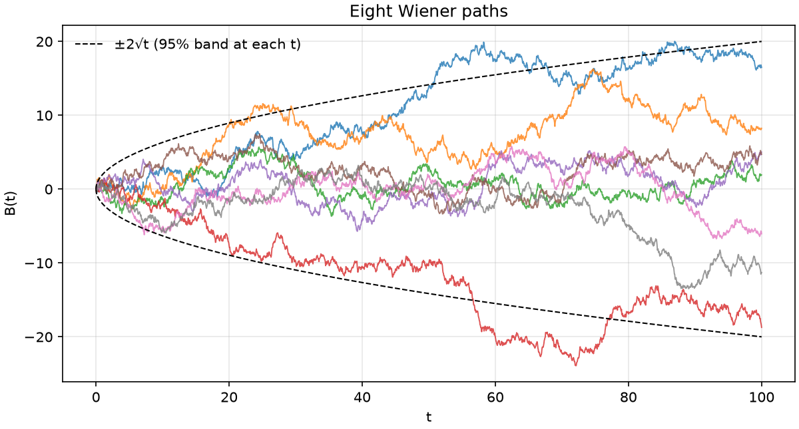
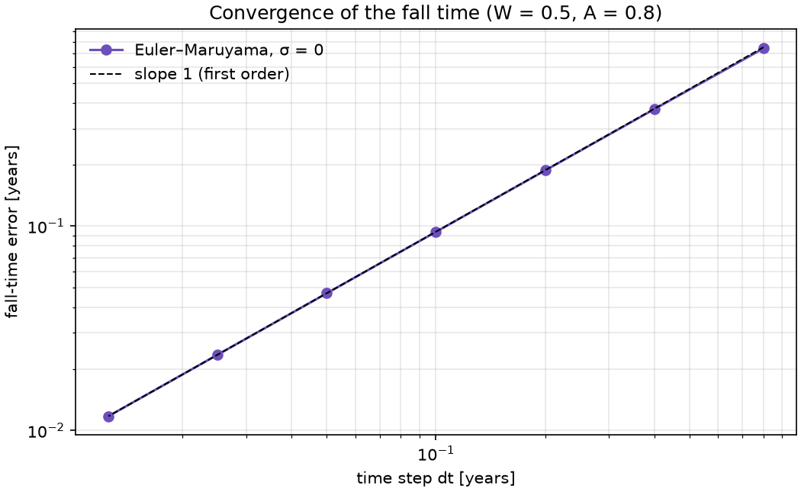
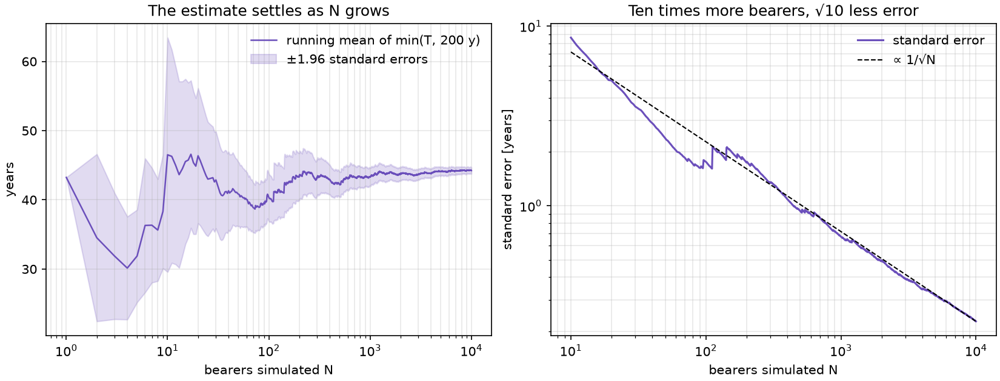
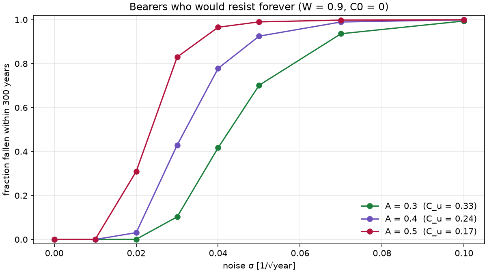

# Lesson 3 · Noise, Euler–Maruyama and first-passage times

> *No bearer lives at constant temptation. Bad days push corruption up, good days pull it down.
> Add that noise to the ODE and the question changes: not "when does the bearer fall?" but "what
> is the distribution of fall times?" Ten thousand simulated bearers answer it.*

**Code:** [`src/corruption/stochastic.py`](../../src/corruption/stochastic.py) ·
**Notebook:** [`03_stochastic.ipynb`](../../notebooks/03_stochastic.ipynb) ·
**Previous:** [Lesson 2 — The point of no return](02-bifurcation.md) ·
**Next:** [Lesson 4 — Kaplan–Meier and racial resistance](04-survival-analysis.md)

## Learning objectives

By the end of this lesson you should be able to

1. describe the Wiener process and write a stochastic differential equation with additive noise;
2. derive the Euler–Maruyama scheme and state its strong and weak orders;
3. implement reflecting and absorbing boundaries, and place a threshold crossing inside a step;
4. estimate a Monte Carlo quantity with its standard error, and size a run to a target precision;
5. explain why noise topples bearers who would resist forever, and estimate how strongly it does;
6. make a parallel Monte Carlo run reproducible bit for bit.

---

## 1. Brownian motion in one paragraph

A **Wiener process** (Brownian motion) $B(t)$ starts at 0, has independent increments, and each
increment is Gaussian: $B(t + h) - B(t) \sim \mathcal N(0, h)$. Its variance grows linearly,
$\operatorname{Var} B(t) = t$, so its typical size grows like $\sqrt t$.



Paths are continuous but nowhere differentiable: zoom in and they stay just as rough. "dB/dt"
does not exist, which is why an SDE is written in differentials.

## 2. The stochastic corruption model

Add a noise term to the corruption ODE:

```math
dC = \underbrace{\big[\alpha u A (1 + \beta C) - \gamma W (1 - C)\big]}_{f(C)}\,dt + \sigma\,dB_t
```

In each short interval dt, corruption moves by the deterministic drift $f(C)\,dt$ plus a random
kick with standard deviation $\sigma\sqrt{dt}$. The noise is **additive**: σ does not depend on C.
That has a useful consequence. The Itô and Stratonovich interpretations of an SDE differ only
when the noise depends on the state, so for this model they agree, and you do not need to choose.

σ has units of corruption per √year. The default σ = 0.02 means that, without drift, corruption
would wander about ±0.02 in one year and ±0.2 in a hundred.

**Boundaries.**
- **C = 0 reflects.** A kick that would take corruption below zero bounces back: $C \leftarrow |C|$.
  This is the stochastic version of the clamp.
- **C = C\* absorbs.** Once a bearer falls, the path stops. The fall time is a **first-passage
  time**: the first moment the path reaches C\*.

## 3. Euler–Maruyama

Integrate the SDE over one step of length Δt:

```math
C_{n+1} = C_n + \int_{t_n}^{t_{n+1}} f(C)\,dt + \sigma\big(B(t_{n+1}) - B(t_n)\big)
\approx C_n + f(C_n)\,\Delta t + \sigma\sqrt{\Delta t}\;Z_n,\qquad Z_n \sim \mathcal N(0, 1)
```

The drift is frozen at the start of the step (as in Euler's method). The noise increment is
exact, because a Brownian increment over Δt *is* a $\mathcal N(0, \Delta t)$ draw.

**How accurate is it?** There are two notions of error:
- **strong error**, the path-by-path error $\mathbb E|C_N - C(T)|$, which matters when you look at
  individual paths;
- **weak error**, the error in expectations $|\mathbb E\,g(C_N) - \mathbb E\,g(C(T))|$, which is
  what a Monte Carlo average sees.

In general Euler–Maruyama has strong order ½ and weak order 1. With additive noise the
troublesome term vanishes and the strong order rises to 1. Without noise (σ = 0) it is plain Euler,
first order, and the closed form of Lesson 1 measures that exactly:



Halving dt halves the error: 0.374 years at dt = 0.4, 0.187 at 0.2, 0.094 at 0.1, 0.047 at 0.05.
The default dt = 0.05 is off by 0.047 years (17 days) in 32.4.

**Placing the fall inside the step.** If $C_n < C^* \le C_{n+1}$, the code interpolates linearly:
$t_{fall} = t_n + \Delta t\,(C^* - C_n)/(C_{n+1} - C_n)$. Without it every fall time would be
rounded up to a grid point, a bias of Δt/2 on average.

**Only step who is still standing.** The code keeps an index of bearers who have not fallen and
updates only those. Most of the population falls in the first 60 years of a 200-year run, so
later steps are much cheaper.

## 4. Monte Carlo and its error bar

A Monte Carlo estimate is a sample average, so the central limit theorem gives its error bar. For
N independent samples with standard deviation s:

```math
\mathrm{SE} = \frac{s}{\sqrt N}, \qquad \text{95\% interval} \approx \hat\mu \pm 1.96\,\mathrm{SE}
```

For a fraction p the standard deviation is $\sqrt{p(1-p)}$. Error falls like $1/\sqrt N$: **ten times
more bearers buys only √10 ≈ 3.2 times less error.**



The left panel tracks the running mean of $\min(T, 200)$ over 10,000 bearers. Censored bearers
count at the horizon, so every sample is finite. The band narrows as N grows; the right panel shows
the standard error following the $1/\sqrt N$ line.

**Discretization error and Monte Carlo error are separate.** For 2,000 bearers, moving from
dt = 0.2 to dt = 0.05 shifts the mean fall time by 0.8 years. Moving on to dt = 0.0125 shifts it by
0.09 years, well inside the statistical error of that sample, about ±0.46 years. Past that point, a smaller
dt costs time and buys nothing visible. A larger N buys more.

## 5. Noise topples resisters

In Lesson 2 a bearer with $C_0 < C_u$ resists forever. With noise, a run of bad luck can carry them
past $C_u$, and from there the drift takes over: there is no way back.



All three bearers (W = 0.9, C0 = 0) resist when σ = 0. As σ grows they start to fall, and the one
with the lowest point of no return goes first.

A classic estimate explains the ordering. Write the drift as the slope of a potential,
$f(C) = -U'(C)$, so $U(C) = -(aC^2/2 + bC)$. Escaping from C = 0 over the barrier at $C_u$ costs
$\Delta U = U(C_u) - U(0) = aC_u^2/2$. **Kramers' law** says the escape rate scales like

```math
\text{rate} \propto \exp\!\left(-\frac{2\Delta U}{\sigma^2}\right) = \exp\!\left(-\frac{a\,C_u^2}{\sigma^2}\right)
```

At σ = 0.03 the exponents $aC_u^2/\sigma^2$ are 4.44, 2.65 and 1.48 for A = 0.3, 0.4 and 0.5. The
simulated fractions fallen within 300 years are 0.10, 0.43 and 0.83, in the same order. The
exponent is exact only for small σ, and the prefactor matters, but the lesson stands: **the
barrier height in units of σ² sets how long a resister lasts.**

## 6. Reproducible parallel Monte Carlo

Two requirements pull against each other:
- **speed:** split 10,000 bearers across processes;
- **reproducibility:** the same seed must give the same answer, however many processes run.

A single random generator shared by workers fails the second, because the order in which workers
draw numbers changes from run to run. The code does this instead:

1. Bearers are split into fixed blocks of `BLOCK_SIZE` = 1024.
2. `SeedSequence(seed).spawn(n_blocks)` gives each block its own independent stream.
3. Workers process whole blocks, in any order.

Block k always draws the same numbers, so serial and parallel runs agree bit for bit. A scenario
test checks it with 2 and 4 workers. One consequence: **changing `BLOCK_SIZE` changes every seeded
result**, so it is a constant, not a tuning knob.

The workers are processes, not threads: the time-stepping loop is many small NumPy calls, and
threads ran 2.5× *slower* than serial because of the GIL. They use the `spawn` start method, which
avoids forking a multi-threaded parent. Spawn re-imports your script in each worker, so **a
script that calls `monte_carlo(..., n_workers > 1)` must put its work under
`if __name__ == "__main__":`**. Without the guard, every worker tries to start its own pool and the
run dies with `RuntimeError: An attempt has been made to start a new process before the current
process has finished its bootstrapping phase`. Notebooks and Streamlit are fine: they are not
re-imported.

## 7. Worked example

**One step by hand.** A bearer with W = 0.6 and A = 0.75 is at C = 0.05. Take dt = 0.05,
σ = 0.02 and a standard normal draw Z = 0.5.

1. Drift: 0.02 × 0.75 × (1 + 3 × 0.05) − 0.02 × 0.6 × (1 − 0.05) = 0.01725 − 0.01140 =
   0.00585/year.
2. Deterministic move: 0.00585 × 0.05 = 0.00029.
3. Random kick: 0.02 × √0.05 × 0.5 = 0.00224.
4. New value: 0.05 + 0.00029 + 0.00224 = **0.0525**.

The kick is almost eight times the drift. Over one step noise dominates; over decades the drift
wins, because drift grows like Δt and noise only like √Δt.

**Ten thousand bearers.** W, A and C0 are Beta-distributed around 0.6, 0.75 and 0.05 (concentration
20), as in notebook 03:

```python
import numpy as np
from corruption.stochastic import SDEConfig, monte_carlo, sample_population

def main():
    population = sample_population(10_000, np.random.default_rng(20261023))
    result = monte_carlo(population, SDEConfig(sigma=0.02), seed=20261023, n_workers=2)
    fell = result.fall_time[result.fell]
    print(f"{result.fraction_fallen:.4f} {np.median(fell):.2f} {fell.mean():.2f}")
    # 0.9962 38.41 43.63

if __name__ == "__main__":
    main()
```

- **Fraction fallen by 200 years:** 99.62% ± 0.06% (SE = $\sqrt{0.9962 \times 0.0038/10{,}000}$).
- **Fall time among those who fell:** median 38.4 years, mean 43.6 ± 0.2 years (sd 20.6).
- **Without noise** the same population has 94.2% falling. Noise added 5.4 percentage points, all
  from bearers whose deterministic fate was to resist.
- The run with `n_workers=2` returns exactly the same array as `n_workers=1`.

## 8. From equations to code

| Concept | Function |
|---|---|
| per-bearer W, A, C0 | `Population(W, A, c0)`, `sample_population(n, rng, W_mean=..., ...)` |
| shared settings (α, β, γ, C\*, σ, u, dt, horizon) | `SDEConfig(...)` |
| Euler–Maruyama with reflection, absorption, interpolated crossing | `_steps` (internal generator) |
| full paths for plotting | `simulate_paths(pop, cfg, rng)` |
| parallel, reproducible Monte Carlo | `monte_carlo(pop, cfg, seed, n_workers=...)` → `MonteCarloResult` |
| censoring at the horizon | `MonteCarloResult.observed_time()`, `.fell`, `.fraction_fallen` |

The tests ([`tests/unit/test_stochastic.py`](../../tests/unit/test_stochastic.py),
[`tests/scenario/test_monte_carlo.py`](../../tests/scenario/test_monte_carlo.py)) check:
- at σ = 0, the fall time matches the closed form, and the error halves when dt halves;
- a resister never falls without noise;
- paths stay in [0, C\*] and are held at C\* after the fall;
- same seed, same result; different seed, different result;
- 2 and 4 workers reproduce the serial run bit for bit;
- the first block is unchanged when more blocks are appended;
- as σ → 0 the mean fall time converges to the deterministic one;
- noise makes some, but not all, deterministic resisters fall.

## 9. Common pitfalls

- **Scaling the noise with dt instead of √dt.** The kick is $\sigma\sqrt{\Delta t}Z$. With
  $\sigma\Delta t Z$ the noise vanishes as you refine the step.
- **Checking the threshold only on the grid.** A path can cross C\* and come back within one step.
  Discrete monitoring misses some crossings and delays others; interpolation fixes the timing, and
  a small dt keeps the misses rare.
- **Treating censored bearers as falling at the horizon.** They have *not* fallen. Averaging
  `observed_time()` gives the mean of min(T, horizon), not the mean fall time. Lesson 4 does this
  properly.
- **One RNG shared by parallel workers.** Results then depend on scheduling. Give each block its
  own `SeedSequence` child.
- **Forgetting the main guard.** With `n_workers > 1` from a script, wrap the work in
  `if __name__ == "__main__":`.
- **Refining dt when N is the bottleneck.** Compare the discretization shift with the standard
  error before paying for a smaller step.

## 10. Exercises

1. What is the probability that a standard Brownian path is outside ±20 at t = 100?
2. A bearer with W = 0.9 and A = 0.3 sits at C = 0.01. Take one Euler–Maruyama step with dt = 0.05,
   σ = 0.02 and Z = −2.5. Where does the bearer land?
3. How many bearers do you need to estimate a fraction near 0.5 to within ±0.01 with 95%
   confidence?
4. Using Kramers' exponent $aC_u^2/\sigma^2$, rank the three bearers of the noise-escape figure at
   σ = 0.02, and compare with the simulated fractions fallen within 300 years: 0.001, 0.031 and
   0.310 for A = 0.3, 0.4 and 0.5.
5. Explain why the Monte Carlo result would change if `BLOCK_SIZE` were set to 512, even with the
   same seed. Would the *statistics* change?

<details>
<summary>Answers</summary>

1. B(100) ~ N(0, 100), so ±20 is ±2 standard deviations: P = 2 × (1 − Φ(2)) = **4.55%**. The dashed
   band in the Wiener figure is this ±2√t envelope.
2. Drift: 0.02 × 0.3 × 1.03 − 0.018 × 0.99 = −0.01164/year, so the deterministic move is
   −0.00058. The kick is 0.02 × √0.05 × (−2.5) = −0.01118. Raw value: 0.01 − 0.00058 − 0.01118 =
   **−0.00176**. Reflection gives **C = 0.00176**.
3. N = 1.96² × 0.25/0.01² = **9,604**. Halving the margin to ±0.005 needs four times as many.
4. a = 0.036, 0.042 and 0.048; $C_u$ = 0.333, 0.238 and 0.167; $aC_u^2$ = 0.0040, 0.0024 and 0.0013.
   Divided by σ² = 0.0004: **10.0, 5.95 and 3.33**. Lower exponent means faster escape, so the
   ranking is A = 0.5 first, then 0.4, then 0.3, matching 0.310 > 0.031 > 0.001. The ratios do not
   match $e^{-\Delta}$ exactly: the prefactor and the finite 300-year window matter too.
5. Each block owns one random stream. With 512-bearer blocks, bearer 600 would draw from block 1's
   stream instead of block 0's, so every individual path changes. The **statistics do not change**:
   the result is just a different, equally valid sample, and the estimates agree within their
   standard errors.

</details>

## Key takeaways

- An SDE adds a random kick $\sigma\sqrt{\Delta t}Z$ to each drift step. With additive noise, Itô and
  Stratonovich agree.
- Euler–Maruyama is first order here (strong and weak) because the noise is additive.
- Reflect at 0, absorb at C\*, and interpolate the crossing inside the step.
- Monte Carlo error falls like $1/\sqrt N$. Report it, and size N from it.
- Noise lets resisters escape over the barrier $aC_u^2/2$. Escape is exponentially sensitive to
  $C_u^2/\sigma^2$.
- Reproducible parallel runs need one seed stream per fixed block, not per worker.

## Further reading

- P. E. Kloeden & E. Platen, *Numerical Solution of Stochastic Differential Equations*, Ch. 9–10
  (Euler–Maruyama, strong and weak convergence).
- D. J. Higham, "An algorithmic introduction to numerical simulation of stochastic differential
  equations", *SIAM Review* 43(3), 2001.
- C. W. Gardiner, *Stochastic Methods*, Ch. 5 (first-passage times) and Ch. 9 (Kramers escape).
- NumPy documentation, "Parallel random number generation" (`SeedSequence.spawn`).
