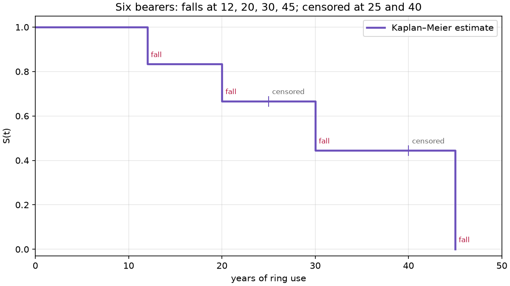
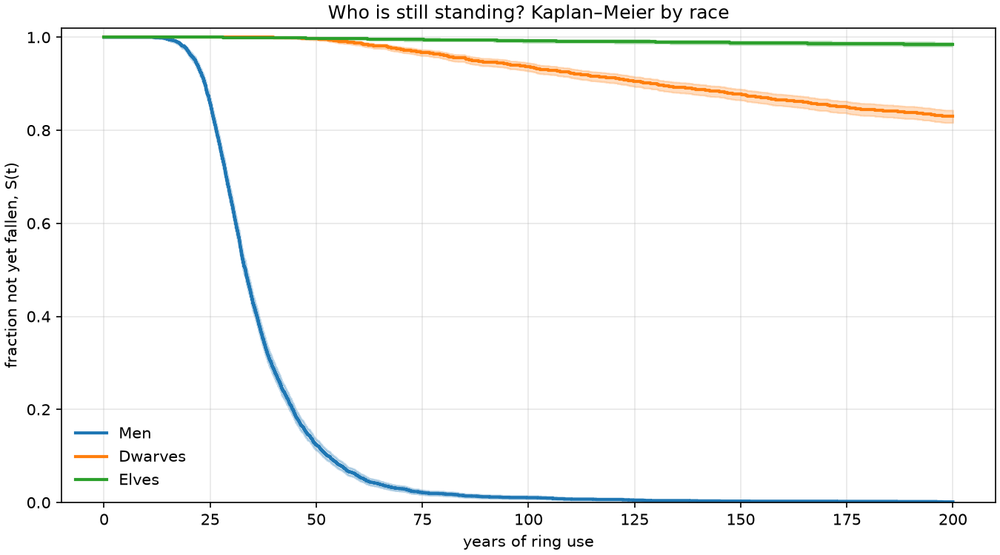
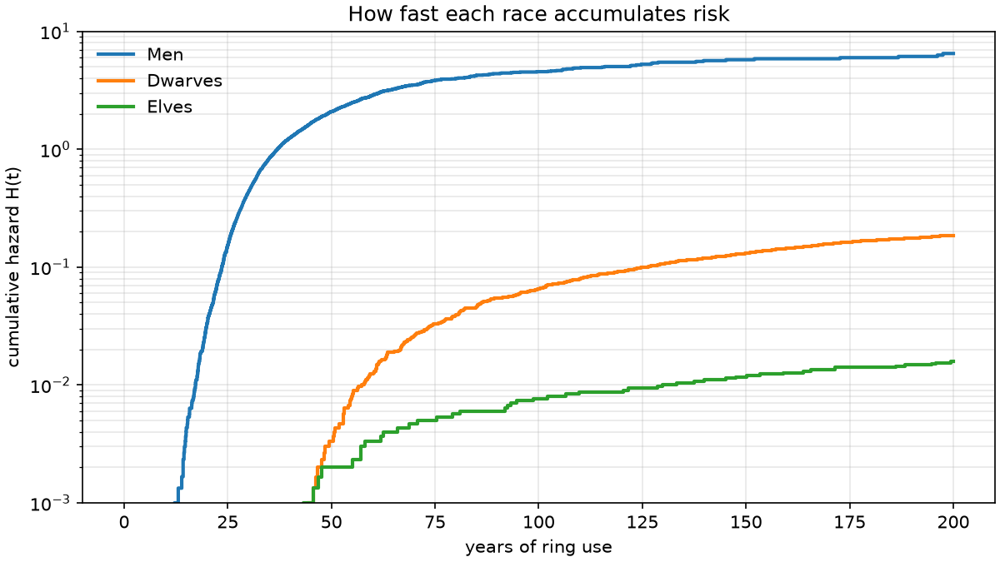

# Lesson 4 · Kaplan–Meier and racial resistance

> *After two hundred years most Dwarves are still standing. You cannot average a fall that has not
> happened yet, and pretending it happened at year 200 is wrong too. Survival analysis is the
> toolkit for exactly this problem: lifetimes that are only partly observed.*

**Code:** [`src/corruption/races.py`](../../src/corruption/races.py) ·
**Notebook:** [`04_races.ipynb`](../../notebooks/04_races.ipynb) ·
**Previous:** [Lesson 3 — Noise, Euler–Maruyama and first-passage times](03-stochastic-monte-carlo.md) ·
**Next:** [Lesson 5 — From model to Streamlit app](05-interactive-app.md)

## Learning objectives

By the end of this lesson you should be able to

1. define the survival function, the hazard and the cumulative hazard, and relate them;
2. explain right-censoring and why both obvious shortcuts give biased answers;
3. compute a Kaplan–Meier curve and its Greenwood confidence band by hand;
4. compute and interpret a log-rank test;
5. report a group whose median survival is undefined;
6. build per-race populations, including a side effect that diverts the ring's pull, and connect
   the results to reliability engineering.

---

## 1. Survival, hazard, cumulative hazard

Let T be the time of the fall. Three functions describe its distribution:

```math
S(t) = P(T > t), \qquad
h(t) = \lim_{\Delta t\to 0}\frac{P(t \le T < t + \Delta t \mid T \ge t)}{\Delta t}, \qquad
H(t) = \int_0^t h(s)\,ds
```

- **S(t)**, the survival function: the fraction still standing at t.
- **h(t)**, the hazard: the rate of falling *among those still standing*. It is a rate, not a
  probability, and it can exceed 1.
- **H(t)**, the cumulative hazard. The three are tied by $S(t) = e^{-H(t)}$.

The shape of the hazard tells a story. A constant hazard means falls happen at random, with no
memory (exponential lifetimes). A rising hazard means wear-out: the longer you hold the ring, the
likelier you are to fall next year. That is exactly what the positive feedback of Lessons 1–2
produces.

## 2. Censoring

The Monte Carlo of Lesson 3 stops at a 200-year horizon. A bearer still standing then is
**right-censored**: we know $T > 200$, not T itself. Real studies censor too: patients leave a
trial, machines are retired before they fail.

Two shortcuts are tempting and both are wrong. Take six bearers who fall at 12, 20, 30 and 45
years, and two who are censored at 25 and 40.

| Approach | Estimated S just after 30 years | Problem |
|---|---|---|
| drop the censored bearers | 1/4 = 0.25 | throws away the information that two bearers survived past 25 and 40: too pessimistic |
| treat censoring as a fall | 3/6 = 0.50 | invents two falls that never happened, and puts them at the wrong times |
| Kaplan–Meier | **0.444** | uses each bearer exactly as long as they were observed |

## 3. The Kaplan–Meier estimator

Order the distinct fall times $t_1 < t_2 < \dots$. At each, let $n_i$ be the number still at
risk (not fallen, not censored) just before $t_i$, and $d_i$ the number who fall at $t_i$. To
survive past $t_i$ you must survive every earlier fall time, so

```math
\hat S(t) = \prod_{t_i \le t}\left(1 - \frac{d_i}{n_i}\right)
```

A censored bearer counts in $n_i$ up to their censoring time, then simply leaves the risk set. No
fall is invented, and no information is thrown away.

**Greenwood's formula** gives the variance:

```math
\widehat{\operatorname{Var}}\,\hat S(t) = \hat S(t)^2 \sum_{t_i \le t} \frac{d_i}{n_i(n_i - d_i)}
```

lifelines builds its confidence band on a log(−log) scale, so the band always stays inside [0, 1].

**The median** is the first time $\hat S$ drops to 0.5 or below. If it never does, because more
than half the group is still standing at the horizon, the median is **undefined**, and lifelines
reports `inf`. That is the honest answer for Dwarves and Elves here.

The **Nelson–Aalen** estimator does the same job for the cumulative hazard:
$\hat H(t) = \sum_{t_i \le t} d_i/n_i$.

## 4. Worked example: Kaplan–Meier by hand

The six bearers from Section 2:

| $t_i$ | at risk $n_i$ | falls $d_i$ | $1 - d_i/n_i$ | $\hat S(t_i)$ | Nelson–Aalen $\hat H$ |
|---|---|---|---|---|---|
| 12 | 6 | 1 | 5/6 | **0.833** | 0.167 |
| 20 | 5 | 1 | 4/5 | **0.667** | 0.367 |
| 25 | (censored: risk set drops to 3) | | | 0.667 | 0.367 |
| 30 | 3 | 1 | 2/3 | **0.444** | 0.700 |
| 40 | (censored: risk set drops to 1) | | | 0.444 | 0.700 |
| 45 | 1 | 1 | 0 | **0** | 1.700 |



- **Median:** S first reaches 0.5 or less at **30 years**.
- **Greenwood at 30 years:** $0.444^2\,(1/30 + 1/20 + 1/6) = 0.444^2 \times 0.25$, so
  SE = **0.222**. With six bearers the curve is very uncertain: lifelines' 95% band at 30 years
  runs from 0.066 to 0.785.

```python
from lifelines import KaplanMeierFitter

kmf = KaplanMeierFitter().fit([12, 20, 25, 30, 40, 45], event_observed=[1, 1, 0, 1, 0, 1])
kmf.survival_function_["KM_estimate"].round(3).tolist()  # [1.0, 0.833, 0.667, 0.667, 0.444, 0.444, 0.0]
kmf.median_survival_time_                                 # 30.0
```

## 5. Comparing groups: the log-rank test

Are two survival curves different, or is the gap noise? The **log-rank test** asks, at every fall
time: given how many of each group were at risk, how many of the falls would group A have
suffered if both groups had the same hazard?

```math
E_{A,i} = d_i \frac{n_{A,i}}{n_i}, \qquad
V_i = d_i\,\frac{n_{A,i}}{n_i}\,\frac{n_{B,i}}{n_i}\,\frac{n_i - d_i}{n_i - 1}, \qquad
\chi^2 = \frac{\left(\sum_i (O_{A,i} - E_{A,i})\right)^2}{\sum_i V_i}
```

Under the null hypothesis $\chi^2$ follows a chi-square distribution with one degree of freedom.
The test is most sensitive when one group's hazard is a constant multiple of the other's
(proportional hazards). It can miss curves that cross.

## 6. Races and the greed diversion

`races.py` gives each race its own Beta distributions of W, A and C0, and its own γ (README for the
values). Dwarves add a side effect: a share κ = 0.5 of the ring's pull feeds **greed** instead of
submission,

```math
\frac{dG}{dt} = \kappa\,\alpha u A, \qquad
dC = \big[(1 - \kappa)\,\alpha uA(1 + \beta C) - \gamma W(1 - C)\big]dt + \sigma\,dB
```

In code this is `Race.sde_config()`, which scales α by $(1 - \kappa)$. G grows linearly while the
bearer holds the ring: the average Dwarf ends with G = 1.29. Each race gets its own `SeedSequence`
child, with separate streams for sampling the population and for the noise.



From 3,000 bearers per race, σ = 0.02, horizon 200 years (notebook 04):

| Race | median fall | S(25) | S(50) | S(100) | S(200) | mean years standing, first 200 |
|---|---|---|---|---|---|---|
| Men | 33.3 y | 0.858 | 0.124 | 0.010 | 0.001 | 36.9 |
| Dwarves | undefined | 1.000 | 0.997 | 0.937 | 0.830 | 186.2 |
| Elves | undefined | 1.000 | 0.998 | 0.992 | 0.984 | 198.6 |

The last column is the **restricted mean survival time** (RMST): the area under $\hat S$ from 0 to
200. Unlike the median, it always exists, so it is the number to quote for groups that mostly
survive.

Every pairwise log-rank test rejects equality overwhelmingly: χ² = 7,262 for Men against Dwarves
and 423 for Dwarves against Elves (p ≈ 10⁻⁹⁴).



The Nelson–Aalen curves show *how* the races differ. Men's cumulative hazard shoots up between 15
and 50 years: a wear-out pattern. A Weibull fit to Men gives shape ρ = 2.24 > 1, an increasing
hazard. Dwarves and Elves accumulate risk slowly and late, mostly from noise-driven escapes
(Lesson 3).

Turn the greed diversion off (κ = 0) and the Dwarf median drops from undefined to **53 years**. The
side effect, not toughness alone, is what keeps Dwarves from becoming wraiths.

## 7. The reliability connection

Replace "bearer" with "bearing" and "fall" with "failure", and nothing in this lesson changes:

| Ring-bearers | Reliability engineering |
|---|---|
| fall time T | time to failure |
| still standing at the horizon | suspended test unit, unit still in service |
| hazard rising with time held | wear-out (Weibull shape > 1) |
| races | designs, suppliers or operating conditions |
| log-rank test | comparing two designs' life data |
| RMST up to 200 years | expected operating time within the warranty window |

## 8. From equations to code

| Concept | Function |
|---|---|
| race presets | `Race(...)`, `RACES` (Men, Dwarves, Elves) |
| greed diversion | `Race.sde_config(base)` scales α by (1 − κ) |
| survival table (time, fell, greed per bearer) | `survival_table(races, n_per_race, base, seed)` |
| Kaplan–Meier per race | `kaplan_meier(table)` → `KaplanMeierFitter` per race |
| medians and S(t) | `median_fall_times(fitters)`, `survival_at(fitters, t)` |
| pairwise log-rank | `pairwise_logrank(table)` |
| survival curves figure | `plotting.plot_survival_curves(fitters)` |

The tests ([`tests/unit/test_races.py`](../../tests/unit/test_races.py)) check:
- the table has one row per bearer and the documented columns;
- censored bearers sit exactly at the horizon;
- only Dwarves accumulate greed, at exactly κα u A per year;
- Men fall faster than Dwarves (medians and S(100)), and the log-rank p-value is below 10⁻⁶;
- Kaplan–Meier starts at 1, and the same seed gives the same table;
- invalid race parameters raise `ParameterError`.

## 9. Common pitfalls

- **Averaging censored times.** The mean of `observed_time()` is the mean of min(T, horizon), and
  it depends on the horizon. Use Kaplan–Meier, or the RMST and say which horizon.
- **Reporting a median that does not exist.** "Median: inf" means more than half survived. Quote
  S(t) at fixed times or the RMST instead.
- **Reading the tail of a KM curve.** With few bearers at risk, each fall makes a big step. In the
  toy example the final fall takes S from 0.444 to 0 because only one bearer was left.
- **Trusting the log-rank test when curves cross.** It sums differences over time, and opposite
  differences cancel. Plot the curves first.
- **Hazard is not probability.** A hazard of 0.2 per year does not mean a 20% chance of falling in
  the next year; that would be $1 - e^{-0.2}$ = 18%.

## 10. Exercises

1. Group A falls at 10, 20 and 30 years. Group B falls at 15 and 35 and is censored at 25. Compute
   the log-rank statistic by hand and check it with `logrank_test`.
2. In the six-bearer example, what are S and its Greenwood standard error at 20 years?
3. Explain why the median fall time of Dwarves is `inf`, and give two numbers you could report
   instead. Compute them from the table in Section 6.
4. Use the cumulative-hazard figure to estimate Men's S(50) from $S = e^{-H}$, given H(50) ≈ 2.1.
   Compare with the Kaplan–Meier value.
5. An average Dwarf has A = 0.70 and holds the ring for the full 200 years. Compute their greed
   G(200). Why is the population mean (1.29) lower?

<details>
<summary>Answers</summary>

1. Event times 10 (A), 15 (B), 20 (A), 30 (A), 35 (B).

   | t | $n_A$ | $n_B$ | d | $E_A$ | $V$ |
   |---|---|---|---|---|---|
   | 10 | 3 | 3 | 1 | 0.5 | 0.25 |
   | 15 | 2 | 3 | 1 | 0.4 | 0.24 |
   | 20 | 2 | 2 | 1 | 0.5 | 0.25 |
   | 30 | 1 | 1 | 1 | 0.5 | 0.25 |
   | 35 | 0 | 1 | 1 | 0 | 0 |

   B's bearer censored at 25 is not at risk at 30. $O_A$ = 3, $E_A$ = 1.9, ΣV = 0.99, so
   χ² = 1.1²/0.99 = **1.222**, p = **0.269**. `logrank_test([10, 20, 30], [15, 25, 35], [1, 1, 1],
   [1, 0, 1])` gives the same. With three bearers per group, no real evidence of a difference.
2. S(20) = 5/6 × 4/5 = **0.667**. Greenwood: $0.667^2(1/30 + 1/20)$ = 0.0370, SE = **0.192**.
3. At 200 years 83% of Dwarves are still standing, so S never reaches 0.5 inside the observation
   window: the median is beyond the data. Report **S(200) = 0.830** (17% fall within 200 years) or
   the **RMST of 186.2 years** out of 200.
4. $e^{-2.1}$ = **0.122**, against the Kaplan–Meier S(50) = 0.124. They agree because the two
   estimators coincide closely when there are many bearers at risk.
5. G = κα u A t = 0.5 × 0.02 × 1 × 0.70 × 200 = **1.40**. The 17% of Dwarves who fall stop
   accumulating greed at their fall time, which pulls the mean down to 1.29.

</details>

## Key takeaways

- $S(t) = e^{-H(t)}$. A rising hazard means wear-out, and positive feedback produces one.
- Censored bearers are information, not missing data. Dropping them or counting them as falls
  both bias the answer.
- Kaplan–Meier multiplies conditional survival probabilities at each fall. Greenwood gives its
  uncertainty.
- The log-rank test compares observed and expected falls at every event time.
- When the median is undefined, report S(t) at a fixed time or the restricted mean.
- Survival analysis of ring-bearers is reliability analysis of components with different names.

## Further reading

- J. P. Klein & M. L. Moeschberger, *Survival Analysis: Techniques for Censored and Truncated
  Data*, 2nd ed., Ch. 4 (Kaplan–Meier, Nelson–Aalen) and Ch. 7 (log-rank tests).
- D. G. Kleinbaum & M. Klein, *Survival Analysis: A Self-Learning Text*, 3rd ed., Ch. 2.
- W. Q. Meeker, L. A. Escobar & F. G. Pascual, *Statistical Methods for Reliability Data*, 2nd ed.,
  Ch. 3 (nonparametric estimation of life distributions).
- lifelines documentation, "Survival analysis with lifelines" and `restricted_mean_survival_time`.
