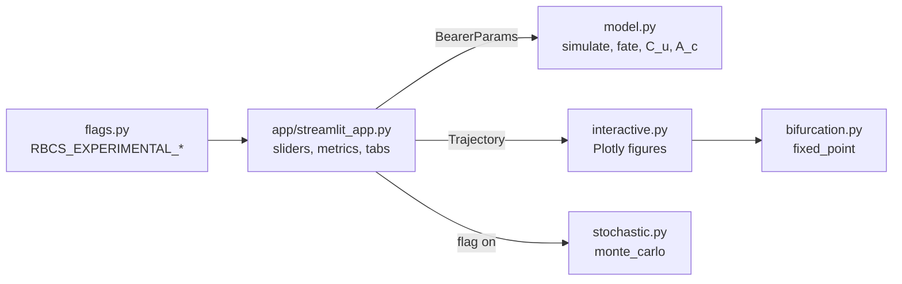
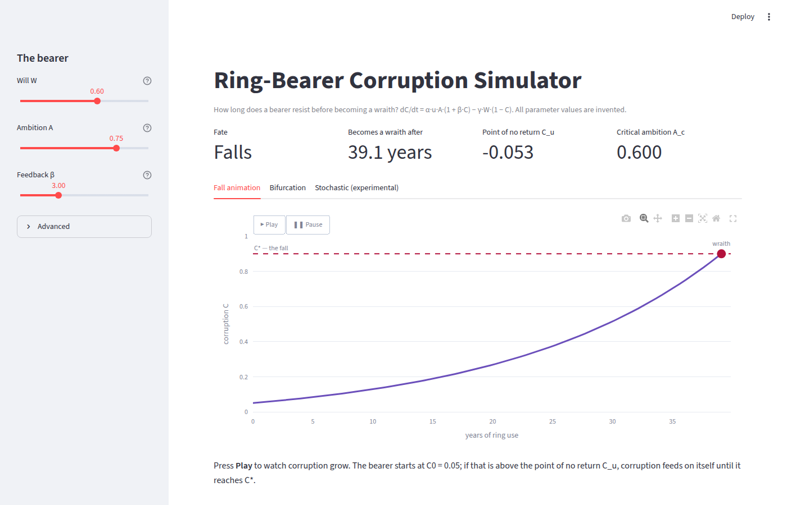
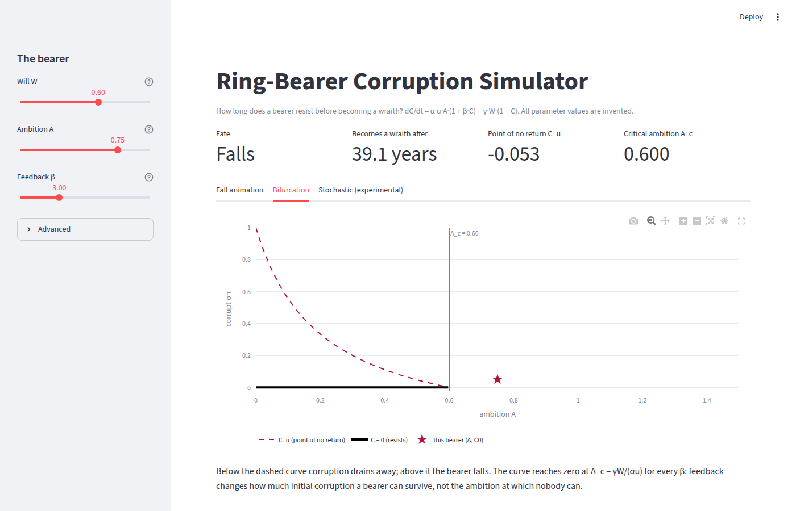

# Lesson 5 · From model to Streamlit app

> *A model nobody can play with convinces nobody. Three sliders and an animation let anyone find
> the point of no return themselves. Doing it well is mostly about keeping the model out of the UI,
> and testing the UI without pretending it is something else.*

**Code:** [`app/streamlit_app.py`](../../app/streamlit_app.py) ·
[`src/corruption/interactive.py`](../../src/corruption/interactive.py) ·
[`src/corruption/flags.py`](../../src/corruption/flags.py) ·
**Previous:** [Lesson 4 — Kaplan–Meier and racial resistance](04-survival-analysis.md) ·
**Next:** [Lesson 6 — How this project knows it is right](06-verification-and-validation.md)

## Learning objectives

By the end of this lesson you should be able to

1. explain Streamlit's execution model (the whole script reruns on every interaction) and what it
   implies for cost and state;
2. structure an app as a thin UI over a pure numerical core;
3. build a Plotly animation from frames, and predict its payload size;
4. budget the cost of one rerun and decide what to cache, flag or cut;
5. put experimental behavior behind an environment-variable feature flag with a safe default;
6. test a Streamlit app headless with `AppTest`, in both flag states, without mocking Streamlit.

---

## 1. Streamlit's execution model

A Streamlit app is a plain Python script. Every time a user moves a slider, Streamlit **reruns the
whole script from the top**, with the widgets now returning their new values. There are no
callbacks to wire and no event loop to manage:

```python
W = st.slider("Will W", 0.0, 1.0, 0.60, 0.01)     # returns the current value on every rerun
A = st.slider("Ambition A", 0.0, 1.0, 0.75, 0.01)
p = BearerParams(W=W, A=A)
traj = simulate(p, t_max=200.0)
st.metric("Fate", "Falls" if traj.fell else "Resists")
```

(A simplified excerpt of [`app/streamlit_app.py`](../../app/streamlit_app.py), which also reads
β and the advanced parameters, and handles falls beyond the horizon.)

The price is that **everything the script does, it does on every interaction**. A slow line is a
slow slider. Section 4 measures what that costs here.

## 2. Architecture: a thin UI over a pure core



The app file does only three things: read widgets, call the package, display results. It contains
no model equations. That gives three benefits:

- **The model is tested once, in the package.** The app cannot drift from the notebooks, because
  both call the same functions.
- **Figures are testable without a browser.** `interactive.py` returns Plotly figure objects, so
  unit tests inspect their traces, frames and annotations directly.
- **The core stays portable.** `model.py` has no Streamlit, Plotly or Matplotlib imports, which keeps
  the C++ port of Project 5 straightforward.

## 3. Animating the fall with Plotly frames

A Plotly animation is a figure plus a list of **frames**. Each frame is a complete replacement for
the figure's data. A Play button tells Plotly.js to step through them in the browser, so once the
figure is sent, playback costs the server nothing.

`fall_animation()` resamples the trajectory to 80 evenly spaced times. Frame k holds two traces:
the path up to time $t_k$ and a marker at its tip. The last frame of a falling bearer turns the
marker red and labels it "wraith".

Because each frame repeats the path so far, frame k carries k points, and the total payload grows
like $n^2/2$:

| Frames | Build time | JSON payload |
|---|---|---|
| 20 | 38 ms | 19 KB |
| 80 (default) | 123 ms | 113 KB |
| 200 | 294 ms | 585 KB |

Going from 80 to 200 frames is 2.5 times as many frames and 5.2 times the payload. Eighty frames is
smooth enough at 40 ms per frame (3.2 s of playback) and keeps each rerun light.

One more practical point: browsers throttle `requestAnimationFrame` in hidden or background tabs,
so an animation in a background tab crawls. That is the browser, not the app.

## 4. The cost of one rerun

Measured locally for the default bearer (W = 0.60, A = 0.75, 200-year horizon):

| Step | Time |
|---|---|
| `simulate` (solve_ivp, 400 output points) | 5 ms |
| `bifurcation_view` | 12 ms |
| `fall_animation` (80 frames) | 123 ms |
| serializing the animation | 15 ms |
| Monte Carlo, 2,000 bearers (experimental tab) | 157 ms |

The ODE solve is nearly free; building the animation dominates. The Monte Carlo tab would roughly
double the rerun, and on shared cloud hardware it could be several times slower. That is why it
sits behind a flag (Section 5). Exercise 3 asks you to cache it.

## 5. Feature flags without a flag service

A **feature flag** separates *deploying* code from *turning it on*. `flags.py` keeps it minimal:

```python
import os

from corruption.flags import Flag

FLAGS = {"EXPERIMENTAL_SDE": Flag(name="EXPERIMENTAL_SDE", description="Show the stochastic tab.")}

def is_enabled(name, env=None):
    raw = (os.environ if env is None else env).get("RBCS_" + name)
    return FLAGS[name].default if raw is None else raw.strip().lower() in {"1", "true", "yes", "on"}
```

The rules that make a flag useful:

- **Default off.** If nobody sets the variable, users get the old, safe behavior.
- **Kill switch.** Unsetting the variable turns the feature off on the next rerun, with no code
  change and no redeploy.
- **Unknown names fail loudly.** `is_enabled("TYPO")` raises `KeyError` instead of silently
  returning False.
- **A registry with an owner and a removal date** ([`docs/flags.md`](../flags.md)). Flags that
  outlive their purpose become permanent branches nobody tests.

Run the app with the experimental tab:

```bash
RBCS_EXPERIMENTAL_SDE=1 uv run streamlit run app/streamlit_app.py
```

A full flag service (OpenFeature, LaunchDarkly, Unleash) adds per-user targeting and percentage
rollouts. For one local app those are overhead, and the README says so. The semantics above are
the part that matters.

## 6. Testing the app for real: `AppTest`

The tempting way to test a Streamlit app is to mock `st.slider` and friends. Then the test checks
your mock, not the app. `streamlit.testing.v1.AppTest` instead **runs the real script headless**,
exposes every widget and element, and lets you set values and rerun:

```python
from streamlit.testing.v1 import AppTest

# Relative paths resolve against the calling file, or the working directory in a REPL.
# Run this from the repository root; the test file uses an absolute path instead.
at = AppTest.from_file("app/streamlit_app.py", default_timeout=60)
at.run()
assert not at.exception
next(s for s in at.slider if s.label == "Will W").set_value(0.95)
next(s for s in at.slider if s.label == "Ambition A").set_value(0.3)
at.run()
next(m.value for m in at.metric if m.label == "Fate")   # "Resists"
```

[`tests/app/test_streamlit_app.py`](../../tests/app/test_streamlit_app.py) checks:
- the default bearer falls and the fall time is shown in years;
- raising will and lowering ambition flips the fate to "Resists" and the time to "never";
- a fall beyond a 20-year horizon is reported as "Falls (later)";
- with the flag off there are exactly two tabs;
- with the flag on (set through `monkeypatch.setenv`) the stochastic tab appears and runs.

The whole file takes about 4.5 seconds and runs in CI as the `app-smoke` job. A smoke test does
not check the numbers. Those are tested in the package. It checks that the wiring holds: that the
script runs, the widgets exist, and the outputs respond to the inputs.

## 7. Worked example: reading the app

Open the app with the defaults (W = 0.60, A = 0.75, β = 3). The metrics row shows:

- **Fate: Falls**, after **39.1 years**;
- **Point of no return C_u = −0.053**: negative, so even a clean start would fall;
- **Critical ambition A_c = 0.600**.

Now lower ambition step by step. At A = 0.60 the bearer still falls, because $C_0$ = 0.05 sits above
$C_u$. The fate flips when A drops below the fate boundary $A_f$ = 0.57/1.15 = 0.496 (Lesson 2):

- **A = 0.50:** falls, after 140 years. The bearer starts just above $C_u$, so the fall is very
  slow.
- **A = 0.49:** resists.

Open the **Bifurcation** tab while doing this: the star marking the bearer moves from above the
dashed $C_u$ curve to below it.

| Default bearer | The same bearer in the bifurcation view |
|---|---|
|  |  |

## 8. From ideas to code

| Concept | Where |
|---|---|
| widgets, metrics, tabs | `app/streamlit_app.py` |
| animated fall | `interactive.fall_animation(traj, p, n_frames=80)` |
| bearer on the bifurcation curve | `interactive.bifurcation_view(p, u)` |
| Monte Carlo histogram | `interactive.fall_time_histogram(result)` |
| flags | `flags.is_enabled(name, env)`, `FLAGS`, `docs/flags.md` |
| headless app tests | `tests/app/test_streamlit_app.py` (AppTest) |
| figure unit tests | `tests/unit/test_interactive.py` |

## 9. Common pitfalls

- **Putting the model in the app file.** It cannot be tested, reused or ported from there.
- **Forgetting that everything reruns.** An expensive computation inside the script runs on every
  slider move. Measure, then cache (`st.cache_data`) or flag.
- **Frames that repeat growing data.** Payload grows quadratically with the frame count. Keep it
  modest, or animate only what changes.
- **Mocking Streamlit.** Use `AppTest`; it runs the real script.
- **Flags without a default or an owner.** A flag needs a safe default, a kill switch and a removal
  date, or it turns into permanent dead code.
- **Expecting edits to `src/` to hot-reload.** Streamlit watches the app script, not the installed
  package. Restart the server after changing the package.

## 10. Exercises

1. With the defaults, find the largest ambition at which the bearer resists, using
   $A_f(\beta)$ from Lesson 2. Then check it in the app.
2. Make the animation's payload grow linearly with the frame count instead of quadratically. What
   do you give up?
3. Wrap the Monte Carlo in the experimental tab with `st.cache_data`. Which arguments must the
   cached function take so that a cache hit is always correct?
4. Add a second flag, `RBCS_EXPERIMENTAL_RACES`, that shows a per-race survival tab. Which files
   change, and what tests do you add?
5. Write an `AppTest` that checks the stochastic tab's histogram title changes when σ changes from
   0.0 to 0.1.

<details>
<summary>Answers</summary>

1. $A_f = \gamma W(1 - C_0)/(\alpha u(1 + \beta C_0))$ = 0.012 × 0.95/(0.02 × 1.15) = **0.4957**.
   The slider moves in steps of 0.01, so A = 0.49 resists and A = 0.50 falls (after 140 years).
2. Draw the full trajectory once as a static, faint trace in `data`, and let each frame update only
   the marker, one point per frame, using `go.Frame(data=[marker], traces=[1])`. The payload becomes
   O(n). You give up the "line drawing itself" effect: the path is visible from the start, and only
   the bearer moves along it.
3. Move the Monte Carlo into a function, e.g.
   `run_mc(W_mean, A_mean, c0_mean, n, seed, alpha, beta, gamma, c_star, sigma, u, horizon)`, and
   decorate it with `@st.cache_data`. **Every input that affects the result must be an argument**,
   including the seed. Anything read from a global or from the environment inside the function would
   make a cache hit return stale results.
4. `flags.py` (new `Flag` in `FLAGS`), `docs/flags.md` (a registry row with owner and removal date),
   `app/streamlit_app.py` (append the tab when enabled), and tests: two in `tests/unit/test_flags.py`
   for the new flag's on and off states, and two `AppTest` cases for the tab's presence and absence.
5. Set `RBCS_EXPERIMENTAL_SDE=1` with `monkeypatch.setenv`, run, set the "Noise σ" slider to 0.0
   and run again. The histogram is the last chart: parse `at.get("plotly_chart")[-1].proto.spec`
   as JSON and read `["layout"]["title"]["text"]`. With the default seed it reads "93.0% fell within
   200 years" at σ = 0 and "100.0% fell within 200 years" at σ = 0.1. Assert the two differ.

</details>

## Key takeaways

- Streamlit reruns the whole script on every interaction. Simple to write, and every line costs.
- Keep the app a thin layer: widgets in, package calls, results out. The model lives and is tested in
  the package.
- Plotly frames replace the figure data; repeating a growing path makes the payload quadratic.
- Measure one rerun before optimizing. Here the animation costs 25 times more than the ODE solve.
- A feature flag needs a safe default, a kill switch, a loud failure on typos and a removal date.
- `AppTest` runs the real app headless; smoke-test the wiring there and test the numbers in the
  package.

## Further reading

- Streamlit documentation: "Main concepts" (the execution model), "Caching" (`st.cache_data`), and
  "App testing" (`streamlit.testing.v1.AppTest`).
- Plotly documentation: "Intro to animations in Python" (frames, `updatemenus`).
- P. Hodgson, "Feature Toggles (aka Feature Flags)", martinfowler.com, 2017.
