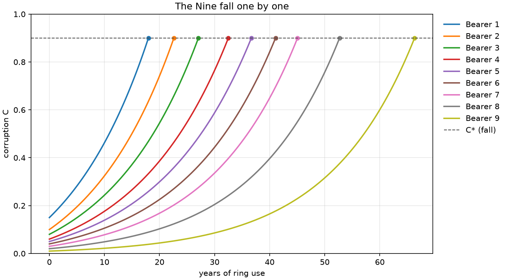
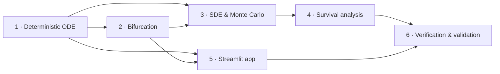

# Ring-Bearer Corruption Simulator: the course

Six lessons, one per phase of this project plus a closing one on verification. Together they build
a model of how a ring-bearer falls, from a differential equation you can solve by hand to a noisy
simulation of ten thousand bearers, survival curves for three races and an interactive app. Each
lesson derives the theory, ties it to the code in this repository, works an example with numbers
computed by that code, and ends with exercises, answers included.



## Lessons

| # | Lesson | Phase | You will learn | Key result |
|---|---|---|---|---|
| 1 | [A corruption ODE you can solve by hand](01-deterministic-model.md) | Deterministic model | modeling with rates, linear first-order ODEs, closed-form fall time, `solve_ivp` with events and tolerances | the ODE is linear: bearer 5 falls at 36.678 y, and the solver agrees to 9 × 10⁻⁸ y |
| 2 | [The point of no return](02-bifurcation.md) | Bifurcation | equilibria and stability, phase lines, boundary equilibria, bifurcation at $A_c$, saddle-node contrast, vectorized sweeps | $A_c = \gamma W/(\alpha u)$ does not depend on β; β acts only through initial corruption |
| 3 | [Noise, Euler–Maruyama and first-passage times](03-stochastic-monte-carlo.md) | Stochastic | Wiener process, SDEs, Euler–Maruyama orders, boundaries, Monte Carlo error, Kramers escape, reproducible parallel runs | 99.6% of 10,000 noisy bearers fall within 200 y (94.2% without noise) |
| 4 | [Kaplan–Meier and racial resistance](04-survival-analysis.md) | Races | survival and hazard, censoring, Kaplan–Meier and Greenwood by hand, log-rank test, RMST, reliability analogy | Men's median fall is 33 y; 83% of Dwarves stand at 200 y, thanks to the greed diversion |
| 5 | [From model to Streamlit app](05-interactive-app.md) | App | Streamlit's rerun model, thin UI over a pure core, Plotly frames, rerun budget, feature flags, `AppTest` | the animation costs 25× the ODE solve, and its payload grows with the square of the frame count |
| 6 | [How this project knows it is right](06-verification-and-validation.md) | All | verification vs validation, a hierarchy of checks, property-based testing, reproducibility, model limits | ten real mistakes, and the check that caught each one |



Read Lessons 1–4 in order: each builds on the model of the previous one. Lesson 5 needs only
Lessons 1 and 2. Lesson 6 looks back at the whole project and can be read at any point, though its
case studies make most sense at the end.

## Prerequisites

- Calculus: derivatives, integrals, the exponential and the logarithm.
- Probability: distributions, expected value, variance, the normal distribution. Lessons 3 and 4
  introduce everything beyond that.
- Enough Python and NumPy to read a 50-line function.
- No prior knowledge of dynamical systems, stochastic calculus or survival analysis is assumed.

## How to use it

1. **Read the lesson.** Every formula is derived. Skip derivations on a first pass if you like.
2. **Run the matching notebook** in [`notebooks/`](../../notebooks) and change the inputs.
3. **Open the code** linked at the top of each lesson. It is short and mirrors the equations.
4. **Do the exercises** before opening the answers. Every answer was computed with the code.

```bash
uv sync
```

```bash
uv run --with jupyterlab jupyter lab notebooks/
```

JupyterLab is not a project dependency. `--with` pulls it in for that command only.

Lesson 5 is best read with the app open:

```bash
uv run streamlit run app/streamlit_app.py
```

## Figures

The teaching figures in [`docs/figures/lessons/`](../figures/lessons) are generated by
[`make_figures.py`](make_figures.py) from the `corruption` package with fixed seeds. The other
figures come from the notebooks. CI rebuilds both on every push.

```bash
uv run python docs/lessons/make_figures.py
```

## Assumptions

Every parameter value in this project is invented. None comes from the books. The full list is in
the [README's assumptions table](../../README.md#assumptions). The lessons quote results "under
these assumptions", and Lesson 6 explains what that means for validation.

## Reference texts

- S. H. Strogatz, *Nonlinear Dynamics and Chaos*: Lessons 1–2.
- E. Hairer, S. P. Nørsett & G. Wanner, *Solving Ordinary Differential Equations I*: Lesson 1.
- Y. A. Kuznetsov, *Elements of Applied Bifurcation Theory*: Lesson 2.
- P. E. Kloeden & E. Platen, *Numerical Solution of Stochastic Differential Equations*: Lesson 3.
- C. W. Gardiner, *Stochastic Methods*: Lesson 3.
- J. P. Klein & M. L. Moeschberger, *Survival Analysis*: Lesson 4.
- W. Q. Meeker, L. A. Escobar & F. G. Pascual, *Statistical Methods for Reliability Data*: Lesson 4.
- W. L. Oberkampf & C. J. Roy, *Verification and Validation in Scientific Computing*: Lesson 6.
